# reRBR (work in progress)

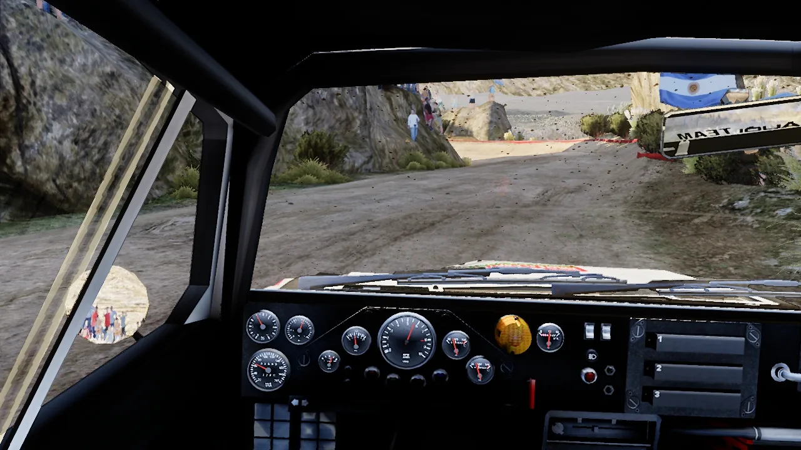

Reimplementation of Richard Burns Rally 1.02 with NGP 7 physics. Not a mod, not a repackage, an actual rewrite from scratch. Everything you know and love, enhanced. Bring your own game files (a RallySimFans install or any RBR + NGP 7 installation).

## Why

- **Native on Linux, macOS and Windows.** No Wine, no Proton.
- **NGP 7 physics.** use the latest NGP version (must be provided by you).
- **The original game around it.** Weather, damage, the service park, the championship and the stage records work
  as in RBR 1.02, checked against recordings of the original.
- **The community's cars and stages.** Any original file format stage and NGP car works out of the box, and community BTB stages work experimentally.
- **A modern look.** A physically based sky and sun, HDR, sun shadows, rain and dust, a lit
  cockpit, windscreen glass and working mirrors.

## Gallery

| | |
|---|---|
| 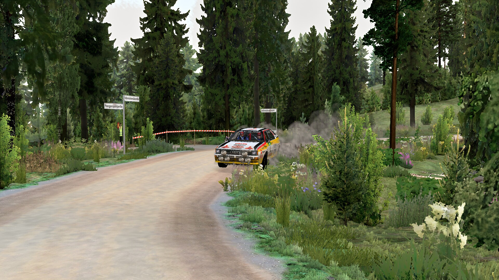 | 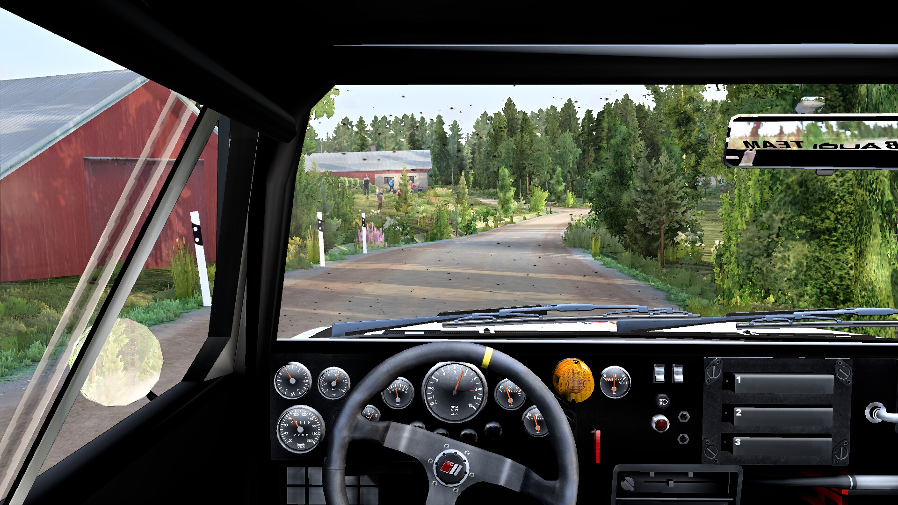 |
| Audi quattro A2 Group B (model by Shenshee), Pengonpohja (stage by Justup & BTBfin) | Audi quattro A2 Group B (model by Shenshee), Pirttikulma (stage by Justup & BTBfin) |
| 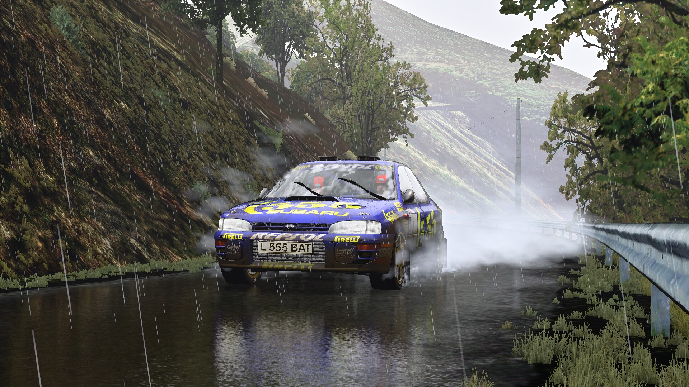 | 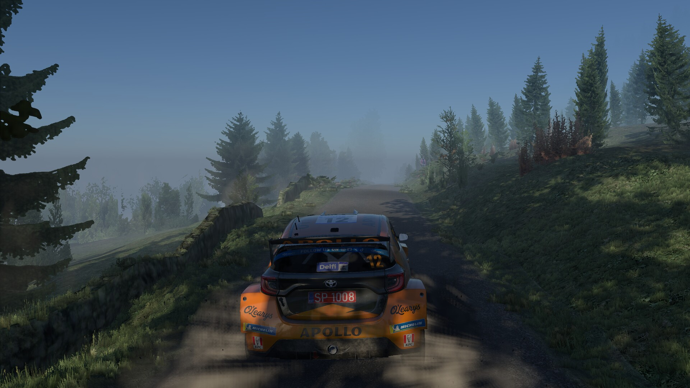 |
| Subaru Impreza GC8 555 Group A (model by gonzo_kool), Luceram Col Saint Roch (stage by Casgra11) | Toyota GR Yaris Rally2 (model by Ha3aP), Comb I (stage by Edd Hartley) |
| 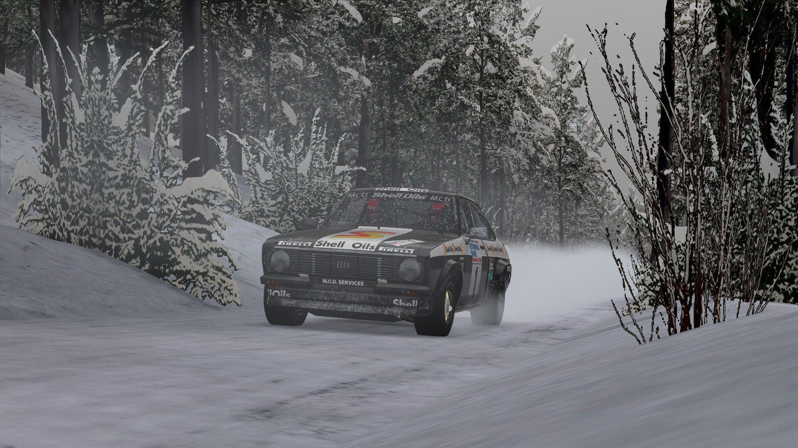 | 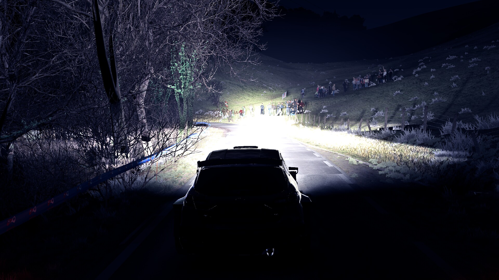 |
| Ford Escort Mk II RS Group 4 (model by Ha3aP, fixed by WorkerBee), Peklo Snow (stage by Miro Kurek) | Ford Fiesta Rally2 (model by G. Rodriguez & D. Antonelli), Gabiria Legazpi (stage by Jan Kaderabek & Lorenzo Clerici) |
| 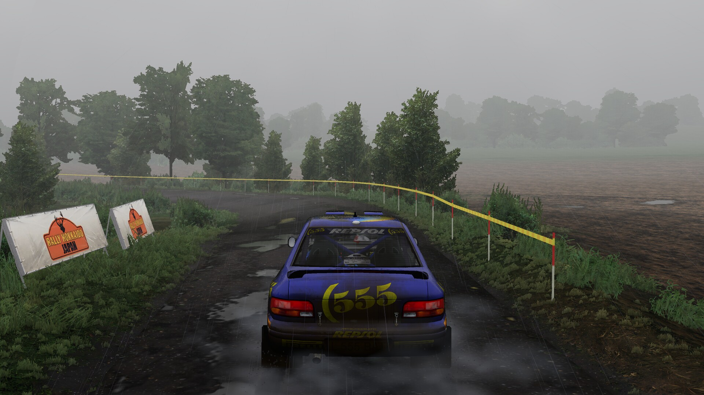 | 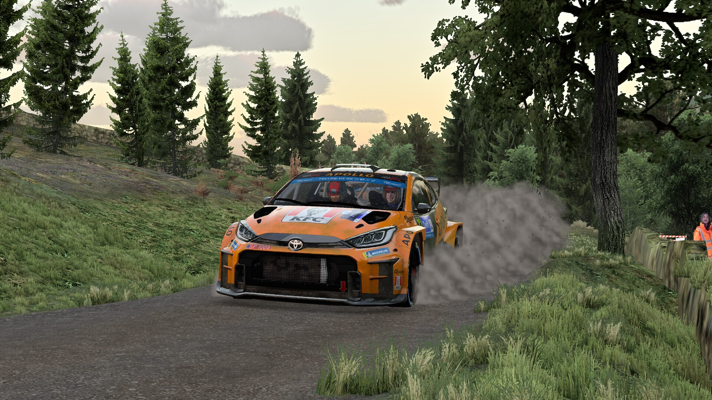 |
| Subaru Impreza GC8 555 Group A (model by gonzo_kool), Sipirkakim, Japan | Toyota GR Yaris Rally2 (model by Ha3aP), Comb I (stage by Edd Hartley) |
| 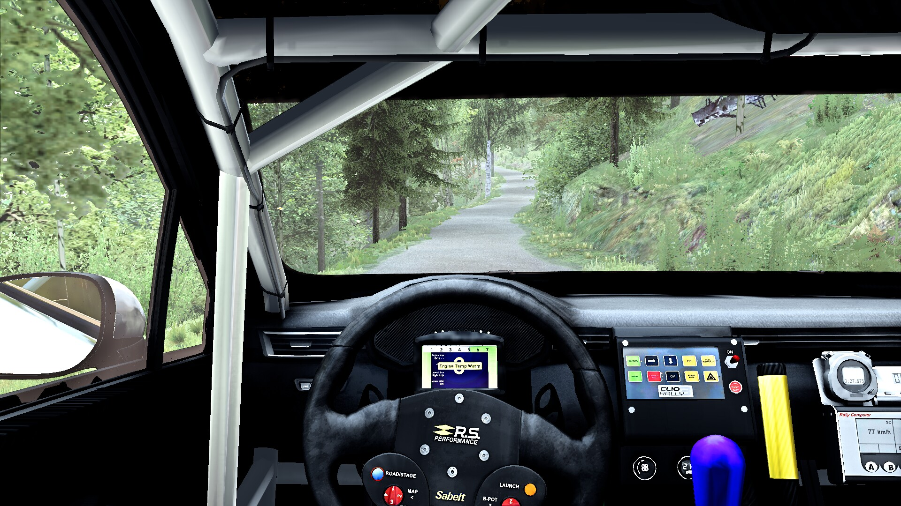 | 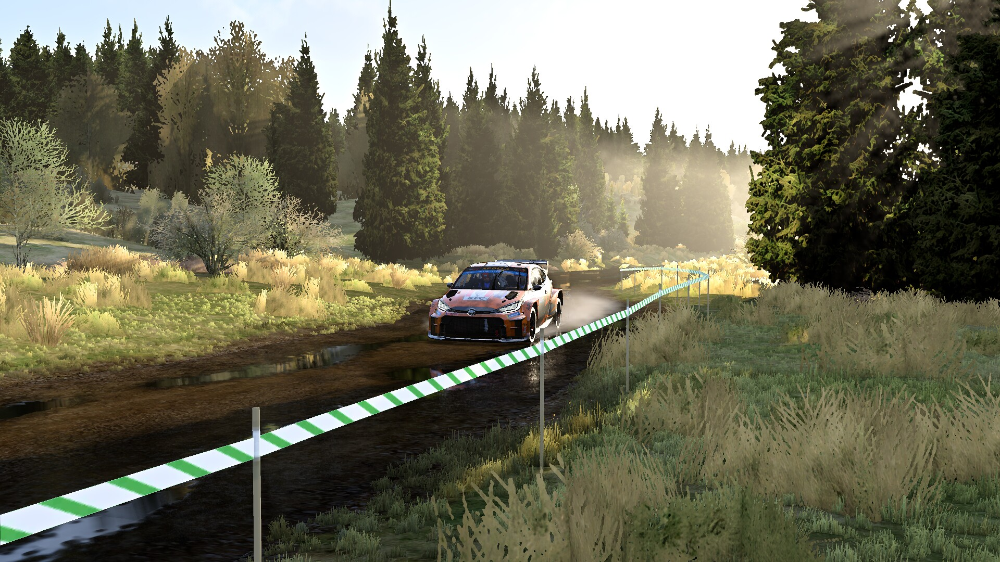 |
| Renault Clio Rally3 (model by DMRally74), Wythop I (stage by Edd Hartley) | Toyota GR Yaris Rally2 (model by Ha3aP), Falstone II, Great Britain |
| 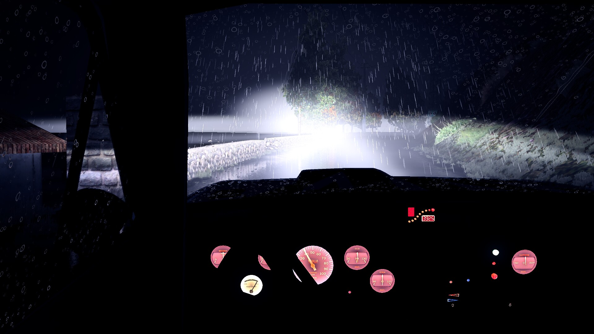 | 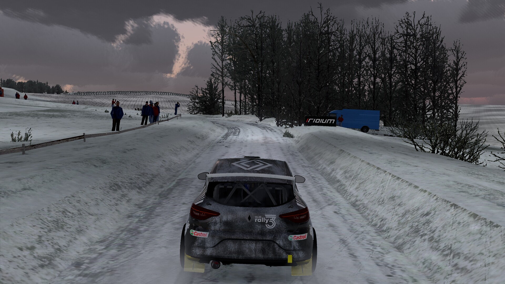 |
| Fiat 131 Abarth Group 4 (model by DMRally74), Luceram Col Saint Roch (stage by Casgra11) | Renault Clio Rally3 (model by DMRally74), Komarov Snow (stage by Miro Kurek, Myra43 & Napa RBR Cup) |
| 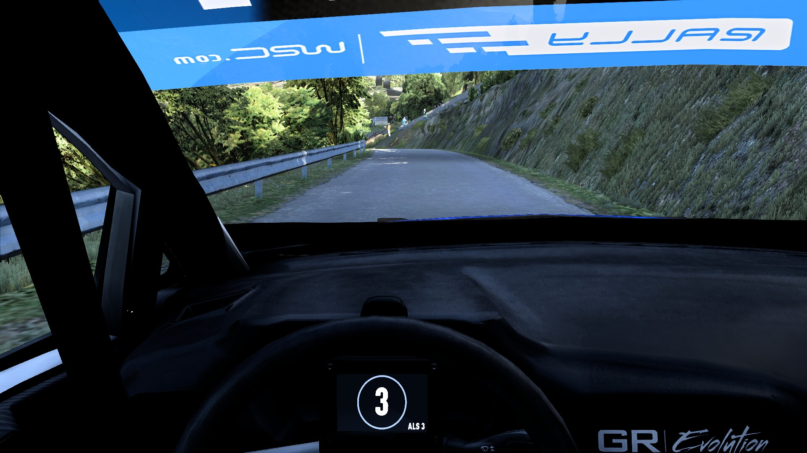 | 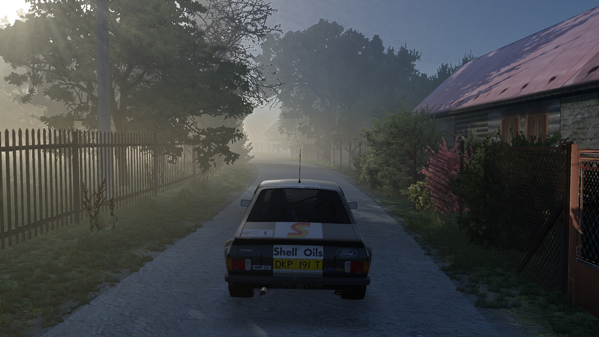 |
| Ford Fiesta Rally2 (model by G. Rodriguez & D. Antonelli), Luceram Col Saint Roch (stage by Casgra11) | Ford Escort Mk II RS Group 4 (model by Ha3aP, fixed by WorkerBee), Semetin 2009 (stage by Vasek Sourek) |

The whole set of 36: [docs/shots](docs/shots/README.md); frames from real drives: [docs/shots/drives](docs/shots/drives/README.md).

## Status

Works today: every retail stage, the community stages (BTB stages experimentally), the quick race and the championship, the rally school (experimentally), NGP physics with the
community cars, the HUD and pace notes, the co-driver, sound, wheels and force feedback. Drives are saved as
ReRBR replays (`.rrp`), with playback and video export from the Replays tab.

The physics is NGP 7.4.778's; the gameplay (weather draws, race flow, damage, service, season, records) is the game's.
Ours, not in 1.02: the launcher in place of the game's menus, the season's car (the game drives your team's), the HUD
and end screens, the wiper switch, the look-back key, the "Best" ghost, night, working mirrors, and the renderer
additions on the Graphics & sound page, set by a quality preset or one by one. The stage always draws at the game's highest quality.

Left out on purpose: original `.rpl` playback, replay cameras and filters, music, co-driver languages other than
English, Richard Burns Challenge, hot seat and custom rallies, unlocks (everything is open),
automatic recovery (H calls for help), TrackIR, EAX and Prologic.

### Known limitations

- **Car sound.** A car with an FMOD sound bank (its pack's, or gvrc.de's when it has one) plays its own sounds. Other cars
  use the retail Impreza's sound. Engine reflections are missing and the rain sound is a
  stand-in.
- **Keyboard steering on a RallySimFans install** moves at a tenth of the retail speed, as in RSF's own game.
- **Community cars.** A car whose model isn't installed is drawn as the retail car RSF names as its stand-in. Car-parts
  options, extra lights and other modder options are not applied; the selected skin is. Community cars and added cars
  share one slot: the same ghosts, and the service park repairs them by that slot's rules. Their setups are their
  own, per car and surface, with RSF's own setups listed too.
- **RSF-encrypted stages** are not decrypted; they stay in the list, marked unavailable.
- **BTB stages** (`RX_CONTENT/Tracks` folders of a RallySimFans install) are drawn without bump or specular maps. Each is a stage of its
  own, with its own records and ghosts; its weathers are retail map 41's (Mont Blanc).
- **Force feedback** uses the first device it finds; set `device =` in the `[ffb]` section of
  `launcher-settings.ini` to pick another.

## Install

ReRBR is in alpha: expect bugs, and please [report them](https://github.com/JodusNodus/rerbr/issues/new/choose).
Development happens mostly on macOS and Linux, so Windows may have more bugs for now.

1. **Download** your system's file from the newest [release](https://github.com/JodusNodus/rerbr/releases).
   Nothing else needs installing, and none of it is signed:
   - **Windows** 10 or later, x86_64: extract the `.zip` and start `rerbr.exe`. At "Windows protected your PC",
     press **More info**, then **Run anyway**.
   - **macOS** 11 or later, Apple silicon: drag ReRBR from the `.dmg` to Applications. The first time macOS blocks
     it: press **Done**, then **Open Anyway** in System Settings → Privacy & Security.
   - **Linux** x86_64: `chmod +x` the `.AppImage` and start it. It needs FUSE 2 or 3; without it, add
     `--appimage-extract-and-run`.
2. **Choose your game folder** at the first start: Richard Burns Rally 1.02 with NGP, a RallySimFans install being
   the easiest ([below](#your-game-with-ngp)).
3. **Get NGP 7.4.778** if Settings asks for it: press **Download NGP 7.4.778…**.
4. Press **Start**.

### Your game, with NGP

ReRBR plays your own copy of Richard Burns Rally 1.02 with NGP 7. At the first start it asks for your game folder.
It looks in the usual places and offers the first install with NGP it finds. The folder can be:
- **A RallySimFans install.** This is the easiest: it has the game, NGP, and the community's cars and stages. The RSF
  installer is a Windows program, so install it on a Windows PC (or under Wine) and copy the whole
  `Richard Burns Rally` folder over.
- **RBR with the official 1.02 patch and the NGP plugin** from [gvrc.de](https://gvrc.de/NGP.html), copied over the
  same way.
- **Only the disc, and no Windows at all:** press **Set up from the disc…**. It builds the game folder from the disc
  image, downloading NGP itself (or taking your copy). See [docs/install-from-disc.md](docs/install-from-disc.md).

ReRBR requires NGP 7.4.778, the version its physics is verified against. Settings finds the game folder's
`Plugins/NGP.dll` automatically; if it is missing or another version (RallySimFans ships 7.5.779), press **Download NGP
7.4.778…**. Its `NGP.dll` and `physics.rbz` go into `NGP 7.4.778/` in your files' folder (below), and the installed
NGP stays as it is. Or use **Browse…** under Advanced to select the 7.4.778 DLL from your NGP package.

ReRBR only reads the game folder; it never changes it.

### Your files

Everything ReRBR writes (settings, bindings, saves in the game's formats, ghosts, setups, added cars, co-driver
packs, replays, videos and logs) goes to one folder, shown on the Settings page:

- macOS: `~/Library/Application Support/ReRBR/`;
- Linux: `$XDG_DATA_HOME/rerbr/`, by default `~/.local/share/rerbr/`;
- Windows: `%APPDATA%\ReRBR\`;
- or `$RERBR_HOME`, if set (for a portable copy).

The launcher works from the keyboard: Ctrl+1 to Ctrl+8 (Cmd on macOS) open its tabs, Tab moves between controls,
Enter or Space presses them, the arrow keys move through lists, and Enter starts the drive.

Drives are saved in `replays/`. Open the launcher's Replays tab to browse them, watch a drive or export an MP4
with game audio to `videos/` or another filename. Video export needs ffmpeg on your PATH. Replays need the build,
game files, profile and setup used for the drive; playback stops if its physics differs.

### Build from source

You need Rust, through [rustup](https://rustup.rs), and SDL3: `brew install sdl3` on macOS. On Linux, your
distribution's SDL3 development package (for example `libsdl3-dev`), plus `pkg-config` and the ALSA and udev
development packages (for example `libasound2-dev` and `libudev-dev`).

```sh
git clone https://github.com/JodusNodus/rerbr.git
cd rerbr
cargo build --release
target/release/rerbr
```

This builds three programs in `target/release/`: `rerbr` (the launcher), `viewer` (the driving window) and
`rbr-standalone` (the physics). Start `rerbr`; it starts the other two.

## Contributing

Found a bug? [Open an issue](https://github.com/JodusNodus/rerbr/issues/new?template=bug_report.yml). When a drive
stops with an error, the launcher offers to open one filled in with the end of its log (in `logs/`).

Start with [docs/development.md](docs/development.md): set up, running it, the code map, the rules and the checks.
The open work is in [notes/status.md](notes/status.md).

The physics and the gameplay must match the original game bit for bit. We record drives in the original running NGP,
and the tests replay them against the Rust code. The recordings are published (`scripts/fetch-test-data.sh`), and CI
runs every pull request against them. The renderer, sound, HUD and launcher are new; they read the physics and never
change it.

## Credits

ReRBR stands on the work of many people. Thank you.

**Richard Burns Rally.** Made by Warthog Games and published by SCi Games in 2004. In memory of Richard Burns
(1971-2005).

**NGP.** WorkerBee, for NGP (Next Generation Physics), the physics ReRBR drives with.
[gvrc.de](https://gvrc.de/NGP.html) hosts NGP and the NGP car packs.

**RallySimFans.** The team that keeps RBR alive, and every car and stage author whose work players drive. The
captions above credit the car models and the community stages shown.

**Plugins and projects we learned from.**
- RBRHUD by Towerbrah: the cockpit dials are drawn from its gauge data.
- RBRControls (Steven Lee, mika-n, Towerbrah, Detegr, RSWats): an initial reference for the advanced H-shifter.
- [NGPCarMenu](https://github.com/mika-n/NGPCarMenu) by MIKA-N: its notes on the game's memory. Copyright (c) 2020
  by MIKA-N. All rights reserved. The full notice, which its licence asks us to keep, is in
  [`notes/references/ngpcarmenu/LicenseText.txt`](notes/references/ngpcarmenu/LicenseText.txt). NGPCarMenu in turn credits
  [Suxin](https://suxin.space/notes/rbr-play-replay/),
  [TheIronWolf](https://gitlab.com/TheIronWolfModding/rbrcrewchief) and the forum posts of WorkerBee, Kegetys,
  black f./jharron, Racer_S and Mandosukai.
- [RBRHshift](https://github.com/Menkaura81/RBRHshift3.5) (Racer_S, mod by Menkaura81).
- The [RBR track exporter for Blender](https://github.com/RichardBurnsRally/blender-track-exporter): the stage file
  formats and shader names.
- [rbr-setup-extractor](https://github.com/wbsth/rbr-setup-extractor) by wbsth.
- [openRBRVR](https://github.com/Detegr/openRBRVR) by Detegr.
- Water sounds: recordings by [EverydaySounds](https://freesound.org/people/EverydaySounds/sounds/268625/) and
  [Breviceps](https://freesound.org/people/Breviceps/sounds/462862/) on Freesound (CC0;
  [`crates/rbr-sound/sounds/CREDITS.md`](crates/rbr-sound/sounds/CREDITS.md)).
- Windscreen sounds: recordings by [domenicodr](https://freesound.org/people/domenicodr/sounds/607129/),
  [leocb](https://freesound.org/people/leocb/sounds/849916/), [Cinetony](https://freesound.org/people/Cinetony/sounds/672703/)
  and [Mirandat7](https://freesound.org/people/Mirandat7/sounds/614993/) (CC0), and
  [tosha73](https://freesound.org/people/tosha73/sounds/547356/) (CC BY 4.0) on Freesound
  ([`crates/rbr-sound/sounds/CREDITS.md`](crates/rbr-sound/sounds/CREDITS.md)).
- Verge sounds: recordings by [Nox_Sound](https://freesound.org/people/Nox_Sound/sounds/559082/),
  [kyles](https://freesound.org/people/kyles/sounds/637547/) and worthahep88
  ([1](https://freesound.org/people/worthahep88/sounds/319208/), [2](https://freesound.org/people/worthahep88/sounds/319215/))
  on Freesound (CC0; [`crates/rbr-sound/sounds/CREDITS.md`](crates/rbr-sound/sounds/CREDITS.md)).

## License

Copyright (C) the ReRBR authors. This program is free software: you can redistribute it and/or modify it under
the terms of the GNU General Public License as published by the Free Software Foundation, either version 3 of the
License, or (at your option) any later version. It is distributed in the hope that it will be useful, but WITHOUT ANY
WARRANTY; without even the implied warranty of MERCHANTABILITY or FITNESS FOR A PARTICULAR PURPOSE. See `LICENSE`.

Not covered: Richard Burns Rally itself, its binaries and its data, which are not in this repository and stay their
owners' property (bring your own copy).
