# reRBR (work in progress)

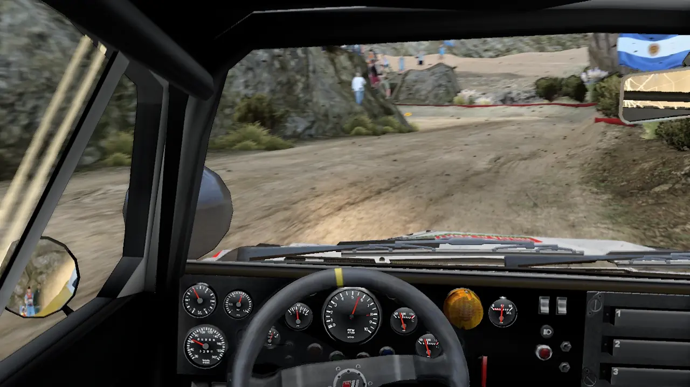

Reimplementation of Richard Burns Rally 1.02 with NGP 7 physics. Not a mod, not a repackage, an actual rewrite from scratch. Everything you know and love, enhanced. Bring your own game files (a RallySimFans install or any RBR + NGP 7 installation).

## Why

- **Native on Linux, macOS and Windows.** No Wine, no Proton.
- **NGP 7 physics.** use the latest NGP version (must be provided by you).
- **The original game around it.** Weather, damage, the service park, the championship and the stage records work
  as in RBR 1.02, checked against recordings of the original.
- **The community's cars and stages.** Any original file format stage and NGP car works out of the box, and community BTB stages work experimentally.
- **Assetto Corsa tracks become stages.** Drop a track folder, `.zip`, `.7z` or `.rar` on Import and ReRBR imports each
  layout as a stage, with the road, scenery, trees, surfaces, pacenotes and timing from the AC files. Gravel and tarmac
  rallies from the AC community work, so the library of stages is far bigger than RBR's own
  ([how it works](docs/assetto-tracks.md)).
- **A modern look.** A physically based sky and sun, HDR, sun shadows, rain and dust, a lit
  cockpit, windscreen glass and working mirrors.

## Gallery

| | |
|---|---|
| 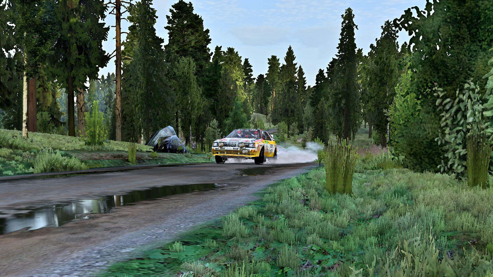 | 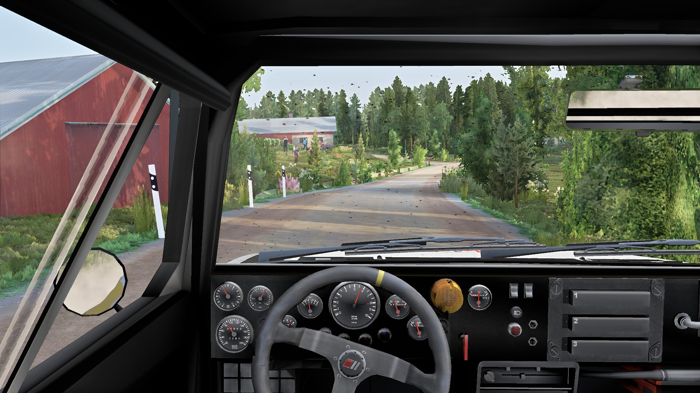 |
| Audi quattro A2 Group B (model by Shenshee), Pengonpohja (stage by Justup & BTBfin) | Audi quattro A2 Group B (model by Shenshee), Pirttikulma (stage by Justup & BTBfin) |
| 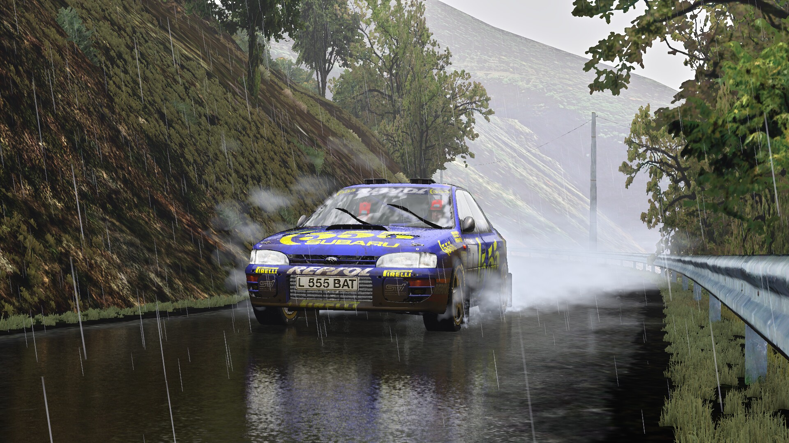 | 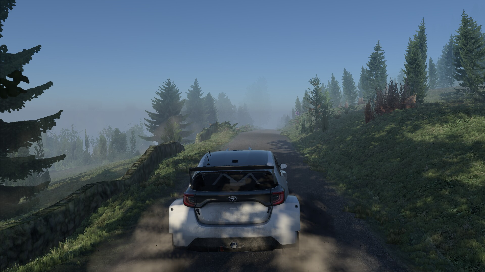 |
| Subaru Impreza GC8 555 Group A (model by gonzo_kool), Luceram Col Saint Roch (stage by Casgra11) | Toyota GR Yaris Rally2 (model by Ha3aP), Comb I (stage by Edd Hartley) |
| 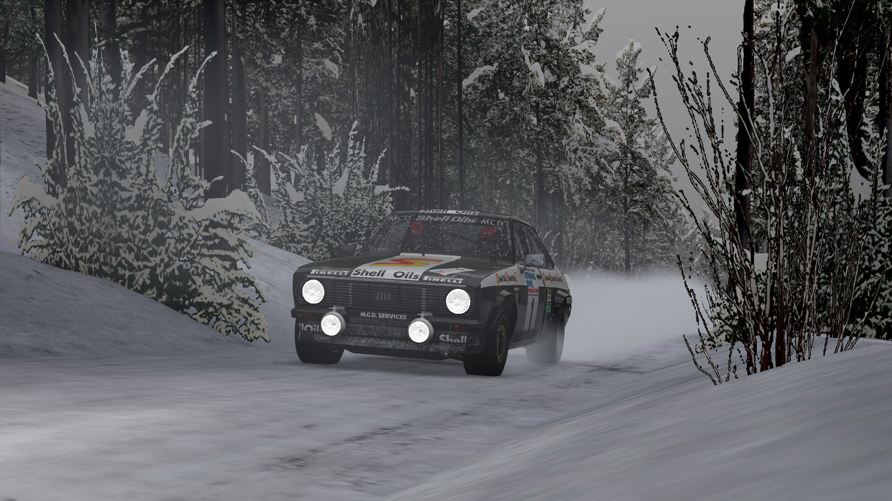 | 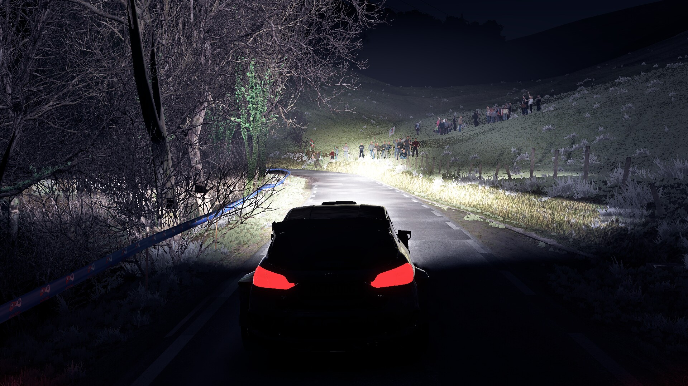 |
| Ford Escort Mk II RS Group 4 (model by Ha3aP, fixed by WorkerBee), Peklo Snow (stage by Miro Kurek) | Ford Fiesta Rally2 (model by G. Rodriguez & D. Antonelli), Gabiria Legazpi (stage by Jan Kaderabek & Lorenzo Clerici) |
| 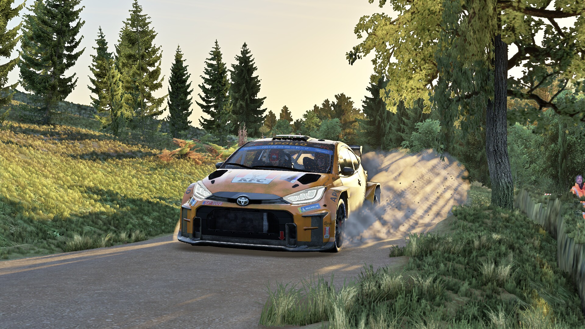 | 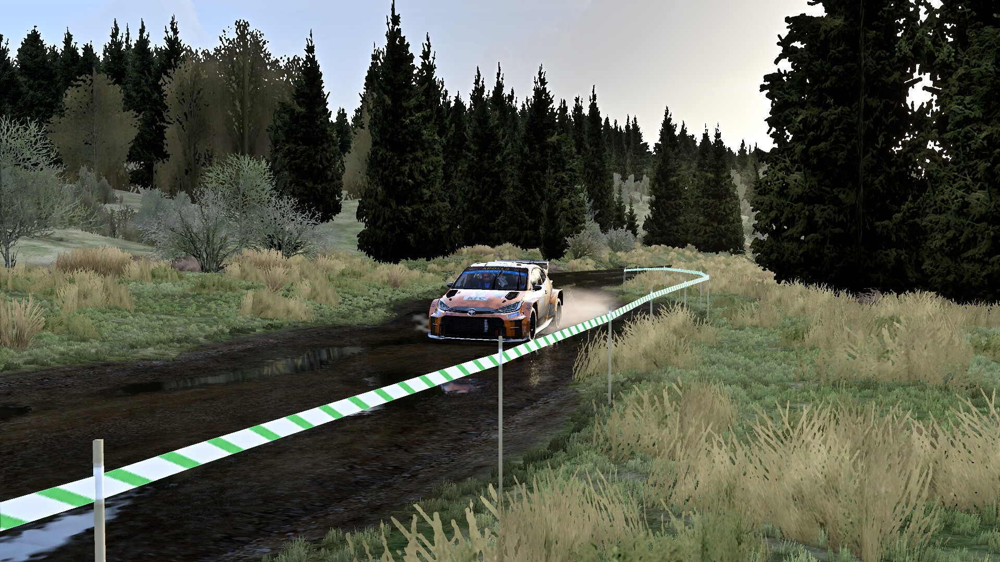 |
| Toyota GR Yaris Rally2 (model by Ha3aP), Comb I (stage by Edd Hartley) | Toyota GR Yaris Rally2 (model by Ha3aP), Falstone II, Great Britain |
| 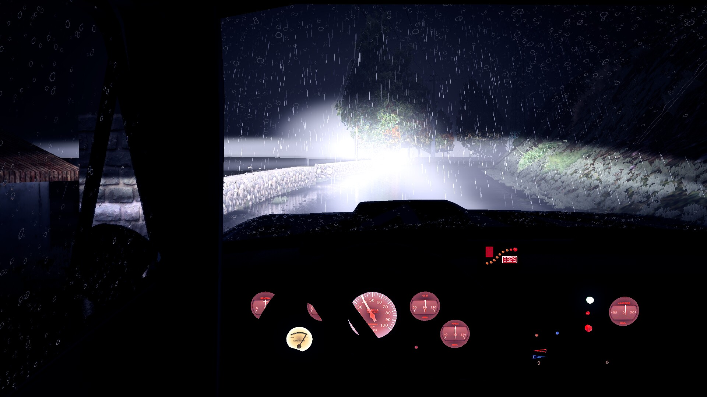 | 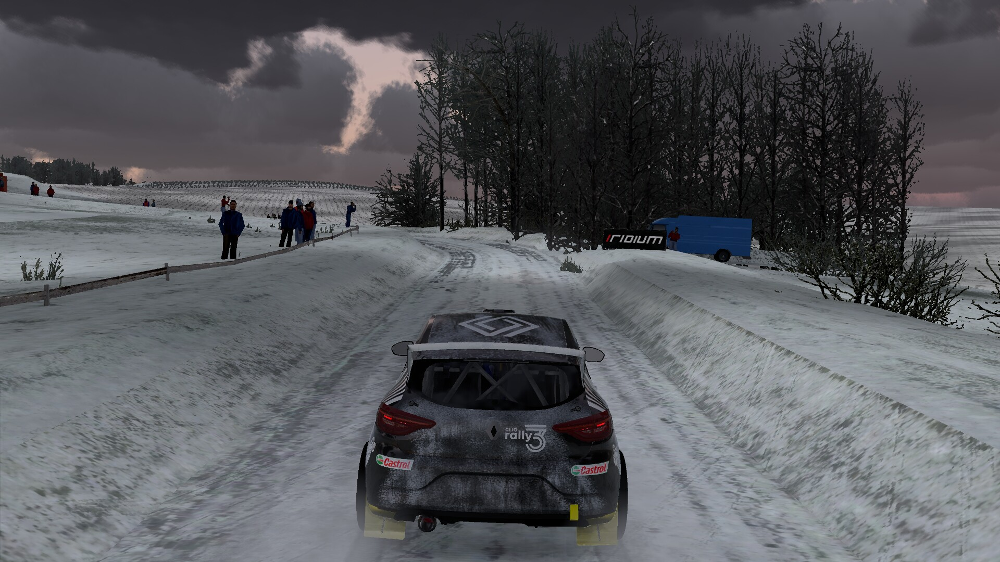 |
| Fiat 131 Abarth Group 4 (model by DMRally74), Luceram Col Saint Roch (stage by Casgra11) | Renault Clio Rally3 (model by DMRally74), Komarov Snow (stage by Miro Kurek, Myra43 & Napa RBR Cup) |
| 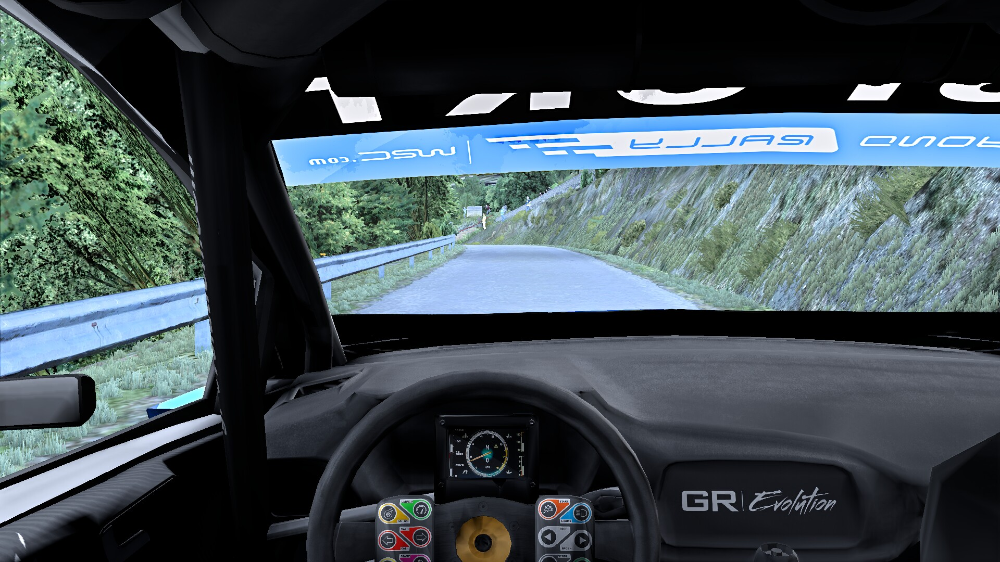 | 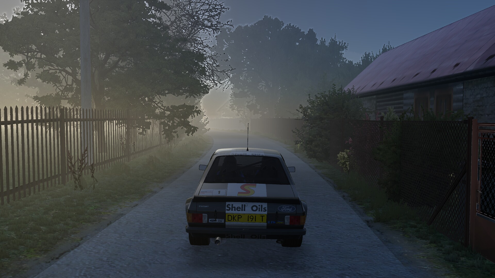 |
| Ford Fiesta Rally2 (model by G. Rodriguez & D. Antonelli), Luceram Col Saint Roch (stage by Casgra11) | Ford Escort Mk II RS Group 4 (model by Ha3aP, fixed by WorkerBee), Semetin 2009 (stage by Vasek Sourek) |
| 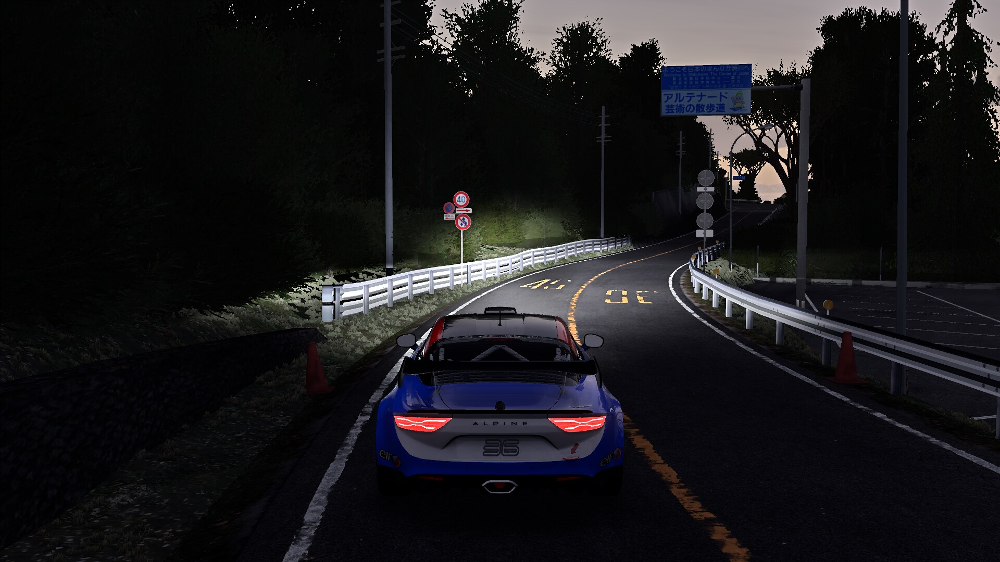 | 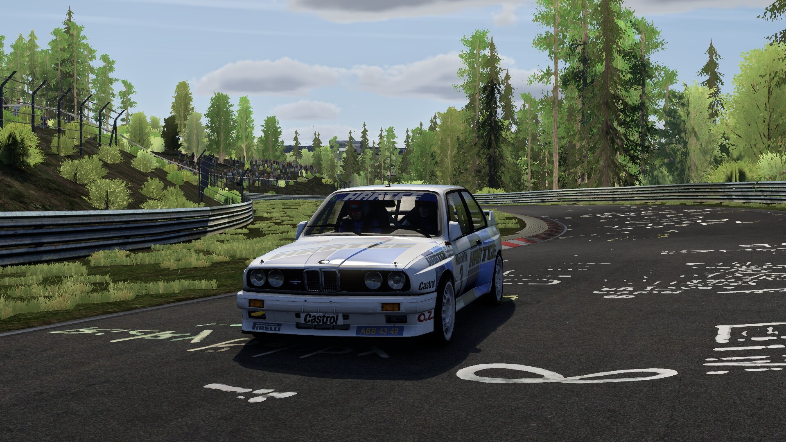 |
| Alpine A110 Rally RGT (model by DMRally74), Akina Uphill (Assetto Corsa track by Project Kaido, imported with ReRBR) | BMW M3 E30 Group A (model by Atiwrc), Nordschleife (Assetto Corsa track, imported with ReRBR) |
| 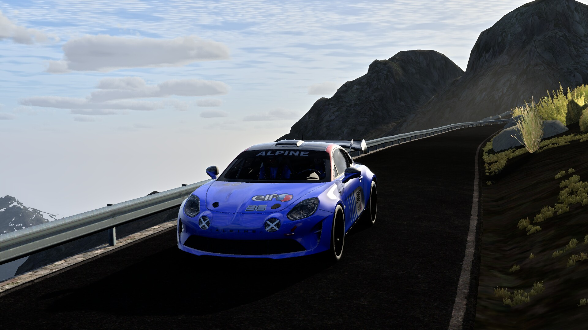 | 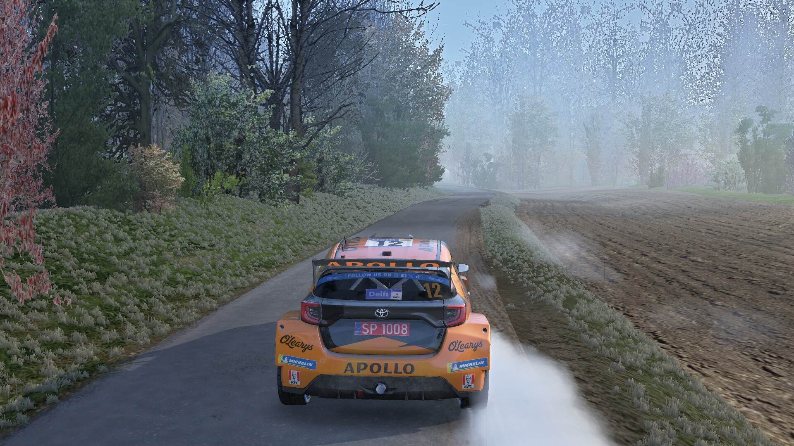 |
| Alpine A110 Rally RGT (model by DMRally74), Sa Calobra (Assetto Corsa track by SuperStage, imported with ReRBR) | Toyota GR Yaris Rally2 (model by Ha3aP), Crequy (Assetto Corsa track by JCRR, imported with ReRBR) |

The whole set of 40: [docs/shots](docs/shots/README.md).

## Status

Works today: every retail stage, the community stages (BTB stages experimentally, and Assetto Corsa tracks imported with ReRBR, [docs/assetto-tracks.md](docs/assetto-tracks.md)), the quick race and the championship, the rally school, NGP physics with the
community cars, the HUD and pace notes, the co-driver, sound, wheels and force feedback. Drives are saved as
ReRBR replays (`.rrp`), with playback and video export from the Replays tab.

The physics is NGP 7.4.778's; the gameplay (weather draws, race flow, damage, service, season, records) is the game's.
Settings > Physics also offers ReRBR experimental physics, opt-in and built on NGP 7: a realistic engine model in
place of NGP's torque formula, with aero drag, downforce and four-wheel-drive drivetrain loss fitted to World Rally
Car telemetry ([docs/experimental-physics.md](docs/experimental-physics.md)).
Ours, not in 1.02: the launcher in place of the game's menus, the season's car (the game drives your team's), the HUD
and end screens, the force-feedback graph of your steering load per car (pause menu), the wiper switch, the look-back key, the "Best" ghost, night, working mirrors, and the renderer
additions on the Graphics & sound page, set by a quality preset or one by one. The stage always draws at the game's highest quality.

### Known limitations

- **Assetto Corsa tracks** are imported as RBR stages, so they don't look or drive exactly as they do in Assetto
  Corsa ([how it works](docs/assetto-tracks.md)):
  - *Grip.* Each AC surface becomes the nearest of RBR's surface classes, so grip and bumps come close to AC's but
    don't match them.
  - *Looks.* Colour textures are kept. Normal and specular maps, Custom Shaders Patch effects (except its trees),
    track scripts and animated scenery are left out.
  - *Route.* The stage follows the track's AI line, `ai/fast_lane.ai`. A layout without one can't be imported, and
    Import lists it with the reason.
  - *Tyres.* One tyre model covers the whole stage: gravel if more than half the route is gravel or dirt, otherwise
    tarmac. On a mixed stage, the shorter part is driven on the wrong tyres.
  - *Pacenotes.* AC tracks have none, so ReRBR generates them from the route. Drive the stage once to check them.
  - The Import is experimental, so the occasional stage will need fixing by hand.
- **RSF-encrypted stages** are not decrypted; they stay in the list, marked unavailable.

## Install

ReRBR is in alpha: expect bugs, and please [report them](https://github.com/JodusNodus/rerbr/issues/new/choose).
Development happens mostly on macOS and Linux, so Windows may have more bugs for now.

1. **Download** your system's file from the newest [release](https://github.com/JodusNodus/rerbr/releases).
   Nothing else needs installing, and none of it is signed:
   - **Windows** 10 or later, x86_64: extract the `.zip` and start `rerbr.exe`. At "Windows protected your PC",
     press **More info**, then **Run anyway**.
   - **macOS** 11 or later, Apple silicon: drag ReRBR from the `.dmg` to Applications. The first time macOS blocks
     it: press **Done**, then **Open Anyway** in System Settings → Privacy & Security.
   - **Linux** x86_64: `chmod +x` the `.AppImage` and start it. It needs FUSE 2 or 3; without it, add
     `--appimage-extract-and-run`.
2. **Start it** and choose your game folder ([below](#your-game-with-ngp)). The launcher takes it from there.

### Your game

ReRBR plays your own copy of Richard Burns Rally 1.02 with NGP 7. The game folder can be:
- **A RallySimFans or other RBR install.** This is the easiest: it has the game, NGP, and the community's cars and stages.
- **Only the disc, and no Windows at all:** the launcher builds the game folder from the disc image
  ([docs/install-from-disc.md](docs/install-from-disc.md)).

## Contributing

Found a bug? [Open an issue](https://github.com/JodusNodus/rerbr/issues/new?template=bug_report.yml). When a drive
stops with an error, the launcher offers to open one filled in with the end of its log (in `logs/`).

Start with [docs/development.md](docs/development.md): set up, running it, the code map, the rules and the checks.
The open work is in [notes/status.md](notes/status.md).

The physics and the gameplay must match the original game bit for bit. We record drives in the original running NGP,
and the tests replay them against the Rust code. The recordings are published (`scripts/fetch-test-data.sh`), and CI
runs every pull request against them. The renderer, sound, HUD and launcher are new; they read the physics and never
change it.

## Credits

ReRBR stands on the work of many people. Thank you.

**Richard Burns Rally.** Made by Warthog Games and published by SCi Games in 2004. In memory of Richard Burns
(1971-2005).

**NGP.** WorkerBee, for NGP (Next Generation Physics), the physics ReRBR drives with.
[gvrc.de](https://gvrc.de/NGP.html) hosts NGP and the NGP car packs.

**RallySimFans.** The team that keeps RBR alive, and every car and stage author whose work players drive. The
captions above credit the car models and the community stages shown.

**Plugins and projects we learned from.**
- RBRHUD by Towerbrah: the cockpit dials are drawn from its gauge data.
- RBRControls (Steven Lee, mika-n, Towerbrah, Detegr, RSWats): an initial reference for the advanced H-shifter.
- [NGPCarMenu](https://github.com/mika-n/NGPCarMenu) by MIKA-N: its notes on the game's memory. Copyright (c) 2020
  by MIKA-N. All rights reserved. The full notice, which its licence asks us to keep, is in
  [`notes/references/ngpcarmenu/LicenseText.txt`](notes/references/ngpcarmenu/LicenseText.txt). NGPCarMenu in turn credits
  [Suxin](https://suxin.space/notes/rbr-play-replay/),
  [TheIronWolf](https://gitlab.com/TheIronWolfModding/rbrcrewchief) and the forum posts of WorkerBee, Kegetys,
  black f./jharron, Racer_S and Mandosukai.
- [RBRHshift](https://github.com/Menkaura81/RBRHshift3.5) (Racer_S, mod by Menkaura81).
- The [RBR track exporter for Blender](https://github.com/RichardBurnsRally/blender-track-exporter): the stage file
  formats and shader names.
- [rbr-setup-extractor](https://github.com/wbsth/rbr-setup-extractor) by wbsth.
- [openRBRVR](https://github.com/Detegr/openRBRVR) by Detegr.
- Water sounds: recordings by [EverydaySounds](https://freesound.org/people/EverydaySounds/sounds/268625/) and
  [Breviceps](https://freesound.org/people/Breviceps/sounds/462862/) on Freesound (CC0;
  [`crates/rbr-sound/sounds/CREDITS.md`](crates/rbr-sound/sounds/CREDITS.md)).
- Windscreen sounds: recordings by [domenicodr](https://freesound.org/people/domenicodr/sounds/607129/),
  [leocb](https://freesound.org/people/leocb/sounds/849916/), [Cinetony](https://freesound.org/people/Cinetony/sounds/672703/)
  and [Mirandat7](https://freesound.org/people/Mirandat7/sounds/614993/) (CC0), and
  [tosha73](https://freesound.org/people/tosha73/sounds/547356/) (CC BY 4.0) on Freesound
  ([`crates/rbr-sound/sounds/CREDITS.md`](crates/rbr-sound/sounds/CREDITS.md)).
- Verge sounds: recordings by [Nox_Sound](https://freesound.org/people/Nox_Sound/sounds/559082/),
  [kyles](https://freesound.org/people/kyles/sounds/637547/) and worthahep88
  ([1](https://freesound.org/people/worthahep88/sounds/319208/), [2](https://freesound.org/people/worthahep88/sounds/319215/))
  on Freesound (CC0; [`crates/rbr-sound/sounds/CREDITS.md`](crates/rbr-sound/sounds/CREDITS.md)).

## License

Copyright (C) the ReRBR authors. This program is free software: you can redistribute it and/or modify it under
the terms of the GNU General Public License as published by the Free Software Foundation, either version 3 of the
License, or (at your option) any later version. It is distributed in the hope that it will be useful, but WITHOUT ANY
WARRANTY; without even the implied warranty of MERCHANTABILITY or FITNESS FOR A PARTICULAR PURPOSE. See `LICENSE`.

Not covered: Richard Burns Rally itself, its binaries and its data, which are not in this repository and stay their
owners' property (bring your own copy).
