# ReRBR experimental physics

ReRBR runs NGP 7's physics bit for bit by default. The launcher's Settings > Physics row (or `--physics experimental`)
offers a second choice, "ReRBR experimental (built on NGP 7)": NGP 7 with some of its systems replaced by ours. Today
it replaces one: a mean-value engine model takes the place of NGP's torque formula. The clutch, gearbox, driveline,
tyres and damage stay NGP's. A tyre model is in development and not part of it ([Tyres](#tyres)).

While it is experimental, a run with it saves no records, ghosts or championship results. Its replays carry the choice
and play back with it.

This page explains what NGP's formula does, what our model does in its place, the evidence behind each part, and how
both compare with BeamNG.drive's published part-throttle model. Every constant with its source is in
[notes/engine-model.md](../notes/engine-model.md), and the code is in `crates/rbr-engine`.

## Why replace NGP's engine formula

NGP's engine is one line of algebra. At a given engine speed it blends two curves by the throttle: the full-throttle
torque curve from the car's file, and a straight braking line. That makes the torque at a fixed rpm linear in the
pedal, with no time in it. A turbo car has no lag, a throttle body has no manifold to fill, and a light pedal at high
rpm behaves like a scaled-down full throttle.

Real engines don't work that way. A nearly closed throttle passes a fixed mass of air per second once the flow chokes,
so the power it allows is roughly fixed and torque falls as rpm rises. A turbo needs exhaust energy before it gives
boost. Engine braking comes from friction and from pumping against a closed throttle, and neither goes to zero at low
rpm. Our model computes these from the air path.

It keeps each car's own full-throttle curve. At full throttle in standard air it gives the car's NGP torque at every
point of the table, except where a turbo can't supply the air yet (see [Torque from air](#torque-from-air)). What
changes is part throttle, transients, idle, engine braking, the limiter and the turbo.

## What NGP's formula does

The engine wrapper in `NGP.dll` (`0x1004b8e0`, ported in `rbr-hybrid/src/ngp/engine.rs` and
`rbr-physics/src/ngp/engine.rs`) returns the crank torque each physics step, 720 times a second. Every RallySimFans
car uses its idle-model path:

```
T = ((1 − t)·B + t·V) / 1.05

B = −(min(ω, ω_limit) / ω_limit) · BrakeCoefficient · MaxTorque
V = damage · (ρ / 1.2041) · Tq(ω) · MaxTorque − friction
```

- `t` is the throttle the control unit passes on, `Tq(ω)` the car's torque table, `ρ` the air density at the car's
  height, `friction` the 1.02 engine sim's extra friction (oil starvation, overheating, damage).
- Above the rev limit `V = 0`. The limiter is a hard fuel cut with the braking line still acting.
- During the control unit's shift cooldown `V` is multiplied by `TorqueCut_NGP`.
- Below the idle speed `t` is ignored and `V` is capped at 5 % of MaxTorque below 0.95·idle. Idle is a limit cycle. On
  one booted car the torque alternates between −13.4 and +106.6 N·m while the engine hovers at 1000–1008 rpm.
- When NGP's 0.15 s speed history shows a stall, the torque is −0.1·MaxTorque.

What follows from it:

- **Part throttle is lazy.** The braking line pulls every part-throttle line down. At 10 % pedal the most torque the
  engine makes at any rpm is 0–2 % of its peak, and at 50 % pedal it is about 40 %.
- **Braking is a line through zero.** `B` is proportional to rpm, so a closed throttle barely brakes at low rpm. On
  turbo cars `BrakeCoefficient` is a share of the boosted MaxTorque, so they brake hard at the limit. Our turbo sample
  car, set up like a 1.6 L Rally2 car with 460 N·m and BrakeCoefficient 0.25, brakes with 115 N·m there, about 9 bar
  of mean effective pressure. The coast curve of a real 2.0 L engine in rFactor 2's engine file gives about 3 bar at
  8000 rpm.
- **No time.** Torque follows the pedal within the step. The 1.02 engine sim still runs underneath and spins its own
  turbo, but its torque is discarded; with our model the turbo sound follows the model's turbo instead.

## The realistic model

Our model is a mean-value engine model, the kind engine control engineers use to design ECUs (Hendricks; Eriksson and
Nielsen; Andersson 2017). It steps once per physics step. "Mean value" means it tracks pressures, flows and speeds
averaged over an engine cycle. It doesn't resolve single combustion events, except at the rev limiter. A four-cylinder
at 7500 rpm fires about every third step at 720 steps a second, so the limiter picks which steps fire. A step costs
about 2.4 µs. Building a car's model takes about 1.3 s for a turbo car and 30 ms for an NA car, once at load.

The model replaces only NGP's torque call. NGP's stall detection, damage factor and shift cooldown, the 1.02 sim's
friction and the air's pressure and temperature reach it each step, and its torque goes back through the same
`/ 1.05`.

### What it reads from each car

| Input | From |
| --- | --- |
| Full-throttle torque curve | `Tq_xx_NGP`, `Tq_xx_RPM_NGP`, `MaxTorque_NGP` |
| Rev limit, idle speed | the control unit's `RPMLimit`, `IdleRPM_NGP` |
| Engine braking at the limit | `BrakeCoefficient_NGP` |
| Displacement | 4 × `CylinderVolume_NGP` (NGP's convention on every car, also the 3-, 5- and 6-cylinder ones) |
| Throttle area | `InletPipeArea_NGP` |
| Turbo or not | `EngineType_NGP` bit 0 |
| Shift cut share | `TorqueCut_NGP` |
| Crank inertia in neutral | `EngineInertia` + `GearBoxInertiaIn` |
| Class and era | RallySimFans' group and year (`cars.json`, `cars_data.json`) |
| Each step | throttle, engine speed, air pressure and temperature, engine temperature, damage, the shift cooldown, NGP's stall answer |

No car file has turbo, throttle actuation, anti-lag, restrictor or cylinder count keys. All 42 installed RallySimFans
cars leave NGP's `Turbo*` keys at their defaults. What the data can't give, the [class rules](#classes) and a short
table of sourced facts give.

### From pedal to torque

```
pedal ──► ECU ──► throttle plate ──► intake manifold ──► cylinders ──► indicated torque
           │            ▲                   ▲                │
           │ idle air,  │                   │ boost          ▼
           │ anti-lag,  │             compressor ◄── shaft ◄── turbine ◄── exhaust
           │ cuts       │
           ▼                                net torque = indicated − friction − pumping
        spark, cut
```

### Throttle

A cable car's plate follows the pedal. A car with a throttle per cylinder (carburettor chokes, slides, individual
throttle bodies) has a progressive linkage, plate = pedal^1.6.

A drive-by-wire car's plate also follows the pedal, through a throttle motor with a 30 ms lag that needs at least
40 ms for full travel. Race ECUs work by position. Life Racing (M-Sport's R5 and Rally2 cars), MoTeC, Link, Haltech
and Marelli all map pedal to throttle position through a table. Link's and Haltech's tables start at one to one.
MoTeC M1 aims at a share of the airflow, which opens the plate more than the pedal at small openings. No rally team's
map is public, so ours is the one to one start. Torque-request pedals belong to road cars' Bosch ME7 and to F1.

The ECU's idle air adds to the plate's aim and anti-lag's kick overrides it. Blips and shift cuts still come from
NGP's control unit through the throttle it passes on.

The plate's open area grows as `1 − cos θ / cos 7°`, from 7° closed to 90° open (US 6591667). At 10 % of its travel a
plate opens about 3 % of its area, at 30 % about 14 %, at 50 % about 33 %. The same patent's flow bench gives a
discharge coefficient of 0.70–0.77 at small openings, a few percent under our 0.8, and a leak of about 5 mm² that we
leave out. At light pedal the two about cancel.

### Manifold

Air flows through the plate as through an orifice, choked below a pressure ratio of 0.528. The cylinders draw it out
at

```
W_cyl = η_v · η_res · p_im · V_d · n / (120 · R · T)
```

and the manifold's pressure follows from the balance, with the manifold's volume as the lag: 0.8·V_d behind one
throttle, 0.3·V_d with a throttle per cylinder, V_d on a turbo plus 2·V_d of boost pipe. The volumetric efficiency
`η_v` follows the torque table's shape on an NA engine (its table is mostly breathing) and is 0.95 on a turbo.
`η_res` is the share of the cylinder left for fresh air after the residual exhaust, from the ideal cycle:

```
η_res = (r_c − (p_em / p_im)^(1/γ)) / (r_c − 1)        r_c 11 NA, 9.5 turbo; γ 1.3
```

It is 1 at full load and 0.71–0.87 at idle.

From this alone come the effects NGP lacks. A small opening passes a fixed mass of air once the flow chokes, so its
torque falls with rpm. A tip-in fills the manifold over a few revolutions. A throttle per cylinder has almost no
manifold and answers at once.

### Torque from air

Indicated torque is proportional to the air in the cylinders (the Willans line), scaled by spark timing and cuts:

```
T_ind = K(n) · m_charge / (4π) · η_ign(Δθ) · (1 − cut) · damage
η_ign = 1 − 2.8e-4 · Δθ²        Δθ: spark retard from best timing, degrees
```

`m_charge` is the air the cylinders take in one engine cycle of two revolutions. `K(n)` is the work per kilogram of
that air: the fuel's energy, the mixture, the combustion's efficiency. The model doesn't guess it. At load it runs its
own engine to a steady state at full throttle every 250 rpm and at every knot of the torque table, and solves

```
K = 4π · (T_table + friction + pumping) / m_charge
```

so steady full throttle gives the table back. On an NA engine `η_v` already carries the table's shape, so `K` comes
out nearly flat.

The table is an upper bound. On a turbo car below its boost threshold this identity would raise `K` to make up for
the missing air, which gives full torque with no boost and erases the lag. Where the steady full-throttle boost misses
98 % of its target, the model holds `K` at the median of the on-boost points instead, and the torque falls short of
the table until the turbo delivers. On the installed cars:

| Car | Held, rpm | Most below the table |
| --- | --- | --- |
| Fiesta R5 | 250–1250 | 8.5 % |
| Rally2, WRC 2014–2020, Polo R5, GR Yaris | 250–1250 | 11.8–16.4 % |
| Xsara WRC 2006 | 250–1250 | 20.3 % |
| Focus WRC 2006 | 250–1250 | 26.5 % |
| Alpine A110 RGT | 1750 | 11.8 % |
| Fiesta Rally4, 208 Rally4, Fiesta R2, Delta HF | one point at 2250–2750 | 0.4–2.8 % |

No other car is held, and every car's steady full throttle stays within 0.1 % of its table or below it.

### Friction

Sandoval and Heywood's component model from MIT (SAE 2003-01-0725) is the standard published one for spark-ignition
engines. It sums crankshaft bearings and seals, pistons and rings, valvetrain and auxiliaries, each a function of bore,
stroke and rpm, with the viscous terms scaled by the oil's viscosity. Bore and stroke come from the displacement as a
square engine. The viscosity follows the 1.02 engine sim's engine temperature through a fit to 10W-40 data, so a cold
engine has up to 2.5 times the friction of a warm one.

One factor per car scales the whole curve. It is set so that a closed throttle at the rev limit, with the fuel cut,
brakes with the car's own `BrakeCoefficient · MaxTorque`, the one braking point NGP gives, and it is clamped to
0.6–2. The installed NA cars land at 1.30–1.87. Every installed turbo car asks for 2.3–4.9 and gets 2, since NGP's
figure is a share of the boosted torque.

### Pumping

The work of pulling air through a nearly closed throttle and pushing it out through the exhaust, as a mean effective
pressure:

```
PMEP = (p_em − p_im) + 0.2 bar · (p_im / p_a) · (n / n_limit)²
```

On overrun, ECU cars cut the fuel and hold the manifold near 0.2 bar with extra air, as real ECUs do (tuners read
17–23 kPa of decel manifold pressure). Friction and pumping together are the engine braking.

### ECU

The parts of a race ECU that change torque:

- **Idle.** An air loop (proportional and integral) and a fast spark loop (proportional), with gains from the car's
  inertia at 0.5 Hz and 3 Hz. The spark sits 27° retarded at idle (η_ign 0.80), a torque reserve the spark loop can
  use either way, as production idle control does. The idle air is capped at the plate's area at 10 % position, down
  to 300 rpm under idle; further down the cap falls to the idle air's base at half idle (anti-stall: enough to catch a
  dip, not to push the car when the clutch drags the engine down). Above idle + 100 rpm the air loop only gives back
  what it gained, so the air it wound up while a clutch bit doesn't hold the engine over idle. Cars from before 1987, on carburettors or mechanical injection, have a fixed idle stop and find their idle speed from the
  balance of air and friction.
- **Overrun fuel cut.** On ECU cars, with the pedal under 2 % above idle + 800 rpm. The fuel returns below idle +
  300 rpm or on the pedal. While the fuel is cut, overrun air holds the manifold at 0.2 bar. When the fuel returns that
  air decays to the idle air over 0.5 s. Fixed-stop cars keep fuelling through the idle circuit.
- **Rev limiter.** It follows Link's convention. The ignition cut ramps from 0 to 100 % between `RPMLimit − 200` and
  `RPMLimit`, and the fuel is cut from `RPMLimit + 100`. The model picks which firings to cut by deterministic error
  diffusion, so the engine bounces just under the limit as a real one does.
- **Shift cut.** The car's `TorqueCut` share as an ignition cut. Air keeps flowing, so the turbo keeps spinning.
- **Stall.** No combustion while NGP reports a stall or below 150 rpm, a starter's cranking speed.

### Turbo

A compressor, a turbine and the shaft between them, with a wastegate, a blow-off valve and an intercooler of
effectiveness 0.7. No rally turbo's map is public, so the compressor and turbine follow generic normalised maps, with
a design speed of 15 000 rad/s and a shaft inertia of 1e-5 kg·m² (Chalmers' T45 has 1.16e-5). The model sizes them
per car at load:

1. The boost target at each rpm is the boost the table's torque needs, capped by the class (2.5 bar absolute on the
   modern classes) and by the restrictor's choked flow.
2. The turbine's nozzle area is fitted so `K` comes out as flat over rpm as the turbo allows. `K` is the fuel's energy
   per kilogram of air and nearly constant, so the boost should carry the table's shape. The exhaust pressure may reach
   at most twice the intake's.
3. Points where the turbo can't make its target are held, as above.

Spool time then comes from the shaft's inertia and the exhaust's energy.

On drive-by-wire cars an electronic wastegate (a base opening by rpm plus a PID loop) aims at a boost that rises with
throttle position:

```
p_aim = p_a + (π_wot(n) · p_a − p_a) · min(1, θ / θ_open(n))
```

`θ_open` is the plate position past which the plate stops limiting the air at full boost: 0.24 at 1000 rpm, 0.46 at
3000, 0.61 at 5000 and 0.74 at 7000 on the turbo sample. Race ECUs' boost aim tables over rpm and throttle (MoTeC M1,
Link G4+) reach full aim before full throttle in the same way. On cable cars a spring wastegate aims at full boost
whatever the pedal, so they kick at part throttle once the turbo lights. That kick is the step in the cable_turbo
figure's 40 % line at 3250 rpm. The spring gate's diaphragm feels the boost through a short hose, so it opens within
about 10 ms, where the electronic gate's actuator takes 125 ms. A tip-in at a fixed 5000 or 6500 rpm spikes the boost
2.5–3.4 kPa (under half a psi) over its steady level; tuners report about 1 psi for a split second on spring gates
(enginebasics). On a stage the Celica, with the 125 ms, ran more than 10 kPa over its steady boost for 16 s of the
171 s it spent at half pedal or more; with the 10 ms, for 0.3 s. A blow-off valve opens at 0.3 bar over the manifold.

### Anti-lag

On cars whose class ran it, anti-lag arms above 45 % of `RPMLimit`. With the pedal under 10 %, for at most 3 s, the
ECU opens the throttle to 20 % of its area, retards the spark 60°, adds 20 % fuel and cuts 30 % of the firings. 60 % of
the unburnt fuel burns in the exhaust manifold, which keeps the turbine spinning toward a boost aim of 1.2 bar gauge.
The blow-off valve stays shut.

## Classes

The class rules come from the FIA articles for each class and RallySimFans' group and year. Without a year a car gets
its group's middle era.

| RallySimFans group | Throttle | Intake | Idle | Anti-lag | Restrictor, boost cap |
| --- | --- | --- | --- | --- | --- |
| Group 4, Group B (NA) | cable | per cylinder | fixed stop | no | none |
| Group B (turbo) | cable | one | fixed stop | Audi from 1985 | none |
| Group A7 (NA) | cable | one, per cylinder from 1993 | ECU from 1987 | no | none |
| Group A8 (NA) | cable | per cylinder | ECU from 1987 | no | none |
| Group A7, A8 (turbo) | cable | one | ECU from 1987 | from 1992 | none to 1989, 40 mm 1990–91, 38 mm 1992–94, 34 mm from 1995 |
| Super 1600 | cable | one | ECU | no | none |
| Super 2000 | cable | per cylinder | ECU | no | none |
| R1, R2, R3, Rally 4 (NA) | drive-by-wire from 2008 | one | ECU | no | none |
| R1, R2, R3 (turbo) | drive-by-wire | one | ECU | yes | 2.5 bar |
| Group N4, R4 | drive-by-wire from 2008 | one | ECU | yes | 32 mm, 33 mm from 2005 |
| WRC 2.0 | drive-by-wire from 1999 | one | ECU | yes | 34 mm, 4 bar (a guess) |
| WRC 1.6 | drive-by-wire | one | ECU | yes | 33 mm, 36 mm from 2017; 2.5 bar |
| R5, Rally 2 | drive-by-wire | one | ECU | yes | 32 mm, 2.5 bar |
| Rally 3 | drive-by-wire | one | ECU | yes | 30 mm, 31 mm from 2022; 2.5 bar |
| Rally 4 (turbo) | drive-by-wire | one | ECU | yes | 30 mm, 2.5 bar |
| RGT | drive-by-wire | one | ECU | yes | 2.5 bar |
| no metadata | cable | one | ECU | no | none |

A short table of facts adds what no rule knows. The Audi quattro A2 has 5 cylinders, the two Porsche 911s 6, and the
Fiesta Rally3, Rally3 Evo and Rally4, the 208 Rally4 and the GR Yaris Rally2 3. The Lancer Evo IX N4 keeps its road
car's cable throttle, the Clio III R3 its road car's drive-by-wire. The Golf II GTI 16V's K-Jetronic has a fixed idle
stop, and the Fiesta R2, an NA car NGP flags as turbo, has no anti-lag.

## Evidence

How firm each part is:

| Part | Basis | Strength |
| --- | --- | --- |
| Full-throttle torque | the car's table, reproduced wherever the air path can make it | the car's data |
| Orifice flow, manifold, turbo shaft and flows | Hendricks' mean-value model; Andersson 2017; Eriksson; NASA's choked flow | textbook |
| Residual gas | the ideal cycle (Heywood) | textbook formula; compression ratios guessed |
| Volumetric efficiency | the NA table's shape; 0.95 on turbos | inferred |
| Friction components | Sandoval–Heywood (SAE 2003-01-0725), from an open implementation that cites the thesis page by page; its worked example reproduced within 4 % | published model; the paper itself is paywalled |
| Friction level | one point per car, NGP's braking at the limit, clamped to 0.6–2 | the car's data, partly |
| Oil viscosity | a Vogel fit through Anton Paar's 10W-40 data | measured data |
| Pumping | the textbook form; its 0.2 bar flow loss picked from a 0.1–0.3 range | textbook form, guessed constant |
| Overrun manifold pressure 0.2 bar | tuners' decel figures, 17–23 kPa | practitioner |
| Spark efficiency | 1 % loss at 6° retard (MIT 2.61), quadratic (US 6363317) | textbook point, fitted curve |
| Idle loops | MoTeC M1 and HP Academy idle setup; the reserve from an idle control paper (arXiv 2012.02859) and US 7418943 | manufacturer docs and papers; loop gains ours |
| Overrun fuel cut | MSExtra, Hondata and tuner thresholds | tuner docs |
| Rev limiter | Link G4+ limiter (HP Academy webinars 084 and 171) | tuner docs |
| Pedal map | MoTeC, Link, Haltech, Life Racing and Marelli docs: position tables starting at one to one, MoTeC M1 by airflow | manufacturer and tuner docs; no rally map is public |
| Plate flow at small openings | US 6591667's flow bench: C_D 0.70–0.77, a 5 mm² leak | measured, one 60 mm throttle |
| Torque at part load | EPA's steady map of the 2013 Ford 1.6 EcoBoost: 27 % of its 100 kPa torque at 50 kPa (ours 28 % at 47 kPa) | measured, one road engine |
| Boost aim by throttle | MoTeC M1 and Link boost aim tables (HP Academy courses) | tuner docs; where full aim starts is ours |
| Class rules | FIA articles 254, 254A, 255, 255A, 260, 261; rallycars.com's restrictor list | regulations |
| Turbo maps | generic normalised shapes, sized per car | inferred: no rally turbo map is public |
| Shaft inertia, spool | Chalmers' GT-Power study of a 1.5 L turbo four (T45, 0.54 s to 90 % at 1000 rpm) | published simulation |
| Anti-lag | Link and HP Academy settings for the kick, fuel and cut | ranges documented; retard, boost aim and burn share guessed |
| Drive-by-wire on modern rally cars | the era and the road engines; homologated ECU actuators | inferred: no team says it outright |

There is no open measured engine-braking curve of a 1.6–2.0 L race engine, so the friction level rests on NGP's own
figure, checked against a published rFactor 2 coast curve of a real 2.0 L engine. Turbo maps and spool rates are
generic. Anti-lag's real torque on overrun is unpublished.

## Compared with NGP and BeamNG

BeamNG.drive described its part-throttle model in 2023 ([Modelling part-throttle torque curves in
BeamNG.drive](https://beamng.com/game/news/blog/throttle-torque-curves/)). Like NGP it authors only the full-throttle
curve per car and computes part throttle from it. Its 2013 model scaled the curve by the throttle. The post says this
made cars hard to drive: "A driver may need to apply excessive throttle inputs to achieve a specific torque output".
Its 2016 "constant power" model lets the pedal set power, so each pedal line follows the full-throttle curve up to
some rpm and then falls as 1/rpm, and the 2023 version rounds those corners following Niels Heusinkveld's research.
Turbo, damage and altitude come on top, and the post lists engine braking as work to do. The post calls a
physics-based engine the ideal it can't afford. Ours is one at the mean-value level, at 2.4 µs a step.

The figures below come from four synthetic sample cars in `crates/rbr-engine/src/samples.rs`, so no game data is in
this repository:

| Sample | Set up like | Engine |
| --- | --- | --- |
| old | Fiat 131 Abarth, Group 4, 1978 | 2.0 L NA, 226 N·m, cable, a throttle per cylinder, fixed idle stop |
| na | 208 R2, 2012 | 1.6 L NA, 190 N·m, drive-by-wire |
| turbo | Fiesta Rally2, 2023 | 1.6 L turbo, 460 N·m, drive-by-wire, anti-lag, 32 mm restrictor |
| cable_turbo | Celica ST185, Group A, 1993 | 2.0 L turbo, 460 N·m, cable, spring wastegate, anti-lag, 38 mm restrictor |

The NGP lines are NGP's formula at a fixed speed, without friction and air density. `cargo run --release -p
rbr-engine --example curves -- DIR` writes the data and `python3 -I crates/rbr-engine/examples/plot.py --figures DIR
docs/images/engine-model` draws them.

### Part throttle

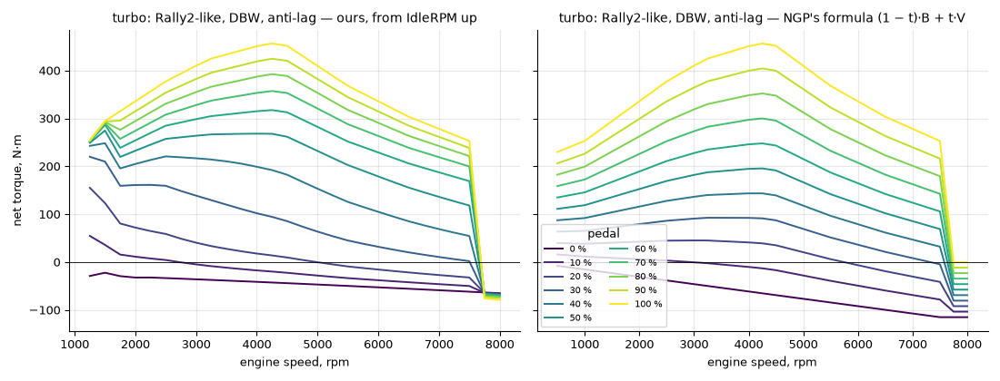

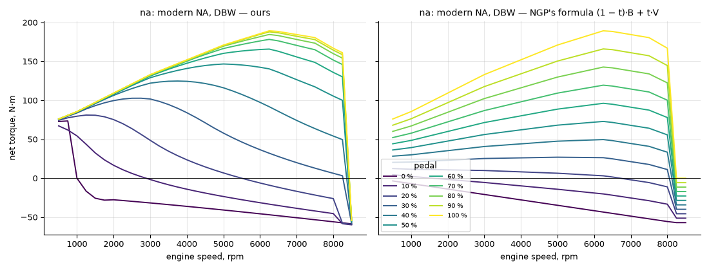

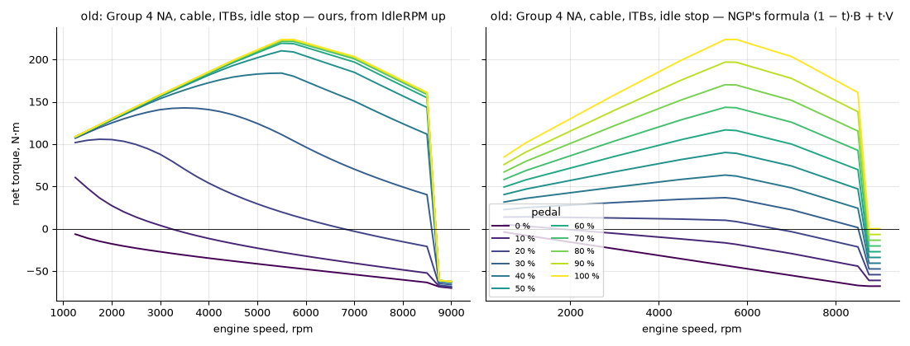

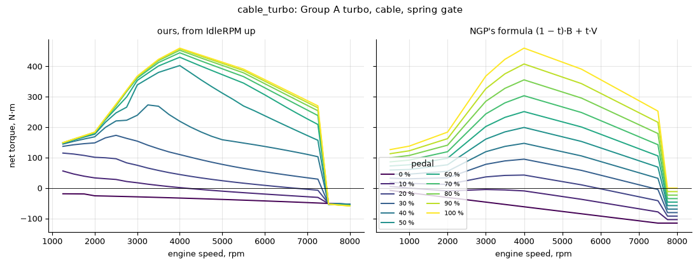

NGP's lines are its full-throttle curve squeezed toward the braking line. Ours follow full throttle up to an rpm and
then fall, the shape BeamNG's 2016 and 2023 models are built to give. In ours it comes from choked flow through the
plate. On the old sample the power above the closed-throttle line stays at 9.8–10.1 kW from 3000 to 8000 rpm at
10 % pedal, and at 36–38 kW at 20 %.

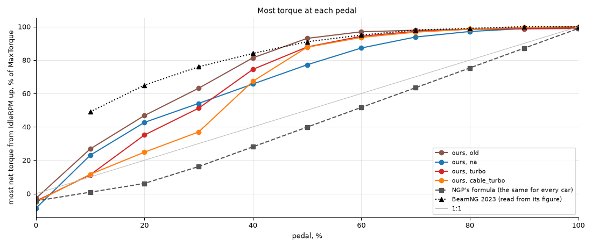

The most net power each pedal position gives at any rpm from idle up, as a share of the full pedal's:

| Pedal | NGP | old | na | turbo | cable_turbo | BeamNG 2023 |
| --- | --- | --- | --- | --- | --- | --- |
| 10 % | 0–1 % | 5 % | 9 % | 8 % | 3 % | 9 % |
| 20 % | 2–8 % | 18 % | 23 % | 20 % | 11 % | 25 % |
| 30 % | 12–19 % | 43 % | 43 % | 47 % | 21 % | 43 % |
| 40 % | 23–31 % | 74 % | 64 % | 72 % | 47 % | 57 % |
| 50 % | 36–42 % | 91 % | 80 % | 87 % | 75 % | 69 % |
| 60 % | 48–53 % | 97 % | 89 % | 97 % | 88 % | 80 % |
| 70 % | 61–65 % | 99 % | 94 % | 98 % | 93 % | 89 % |
| 80 % | 74–77 % | 99 % | 97 % | 99 % | 97 % | 94 % |

And the most net torque, as a share of peak torque:

| Pedal | NGP | old | na | turbo | cable_turbo | BeamNG 2023 |
| --- | --- | --- | --- | --- | --- | --- |
| 10 % | 0–2 % | 26 % | 40 % | 27 % | 13 % | 49 % |
| 20 % | 6–10 % | 46 % | 53 % | 47 % | 25 % | 65 % |
| 30 % | 14–21 % | 63 % | 65 % | 63 % | 37 % | 76 % |
| 40 % | 26–32 % | 81 % | 76 % | 78 % | 68 % | 84 % |
| 50 % | 38–43 % | 93 % | 86 % | 91 % | 87 % | 91 % |
| 60 % | 51–55 % | 97 % | 92 % | 97 % | 93 % | 95 % |
| 70 % | 63–66 % | 98 % | 96 % | 98 % | 97 % | 98 % |
| 80 % | 75–77 % | 98 % | 98 % | 99 % | 98 % | 99 % |

BeamNG's values are read from its published plots, and the NGP columns span the four samples. Power compares better:
at light pedal the torque share mostly says how strong a car's full-throttle curve is near idle, where every light
pedal line meets it.

On power, the drive-by-wire samples follow BeamNG up to 30 % pedal and give more from 40 % up. Two samples give less at
light pedal, for reasons in their hardware. The old car's throttles per cylinder sit on a progressive linkage. The
cable turbo makes its full power on boost, and at light pedal it is an NA engine until the turbo spins. BeamNG scales
power with the pedal whatever the turbo does.

An earlier version mapped the drive-by-wire pedal as pedal^1.3, from HP Academy's drive-by-wire webinar (40 % pedal,
about 30 % throttle), and gave about half BeamNG's power at 10–20 % pedal. That calibration is a Haltech on a street
Nissan 350Z, shaped to hold a steady speed on the road. The rest of the chain checks out against measurements: the
plate flow above, and EPA's steady map of the 2013 Ford 1.6 EcoBoost, which makes 27 % of its 100 kPa torque at
50 kPa of manifold pressure where ours makes 28 % at 47 kPa.

BeamNG's curve isn't measured data either. Niels Heusinkveld, whose research the post credits, measured other sims,
not cars. Of the chart behind his proposed shape he says it "might also be completely fictional". Forum readings of
BeamNG's engine code have it apply friction and engine braking apart from these curves, so the plotted lines are most
likely torque before friction. Net, its 10 % line would brake at 8500 rpm, as ours does, since the air through a small
opening sets the indicated power and friction and pumping take their share first. Its power plot's 0 % line repeats
the torque plot's values on the kW axis.

### Engine braking

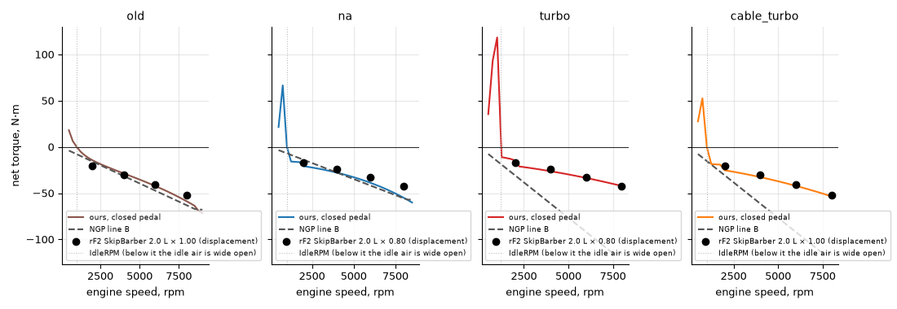

Closed pedal, N·m, ours / NGP / the rFactor 2 2.0 L coast curve scaled by displacement:

| Sample | 2000 rpm | 4000 rpm | 6000 rpm | 8000 rpm |
| --- | --- | --- | --- | --- |
| old | −17.6 / −15.8 / −20.8 | −34.4 / −31.5 / −29.8 | −47.6 / −47.3 / −40.6 | −60.2 / −63.1 / −52.5 |
| na | −27.7 / −13.9 / −16.6 | −36.2 / −27.8 / −23.9 | −45.7 / −41.7 / −32.6 | −55.9 / −55.6 / −42.1 |
| turbo | −32.0 / −30.7 / −16.6 | −41.2 / −61.3 / −23.9 | −52.6 / −92.0 / −32.6 | −64.8 / −115.0 / −42.1 |
| cable_turbo | −38.0 / −30.7 / −20.8 | −51.1 / −61.3 / −29.9 | −66.0 / −92.0 / −40.7 | −82.1 / −115.0 / −52.5 |

NGP's braking line goes through zero at 0 rpm. Ours has a large part that doesn't fall with rpm, friction and pumping
at a closed throttle, and so does BeamNG's 0 % line, which runs almost flat from about −70 N·m at 500 rpm to −90 N·m
at 8500 rpm on an engine of about 600 N·m. At the rev limit ours matches NGP on NA cars, since that is where the
friction is calibrated. On turbo cars ours brakes about half as hard as NGP at high rpm, because of the clamp.

Below idle the figure's curves rise. With the pedal closed the ECU's idle air opens to its ceiling to stop a stall,
down to 300 rpm under idle, then less: the turbo sample gives +110 N·m at 1000 rpm, +93 at 750 and +51 at 500 (was
+166 at 500 with the whole ceiling at any speed).

In gear with the pedal closed a car creeps at its idle speed in first, as a real one does: on the flat the Fiesta
Rally2 creeps at 10.8 km/h (idle 1200 rpm; NGP 11.0 km/h), the Fiesta R2 at 9.5 and the Golf II GTI 16V, on its fixed
idle stop, at 5.5. Braked in gear, it stalls: with the brake rising to full over 16 s the Rally2 stalls at 20 % brake
with at most 90 N·m from the engine (152 before; NGP at 45 %), about where a car with no engine would stop; the R2 at
18 % (46 N·m), the Golf at 9 % (23 N·m). The ECU cars still pull away from rest at a closed pedal, with clutch help on
or off; the Golf needs a touch of throttle.

### Response

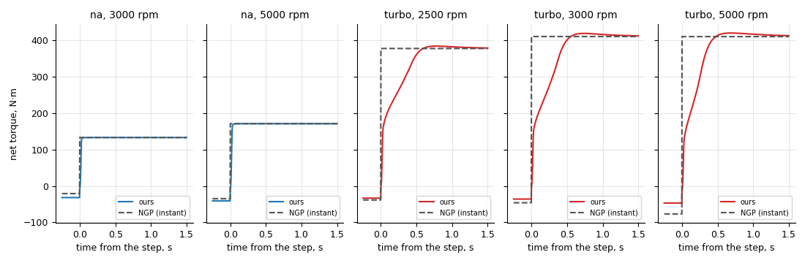

NGP's torque follows the pedal within the step and its turbo cars have no lag. In ours, from a closed pedal to full
pedal at a fixed speed, the drive-by-wire NA sample reaches 90 % of its torque in 25–28 ms, the throttle motor's lag
and the manifold's filling. The old sample, with a throttle per cylinder on a cable, gets there within the step. The
turbo sample's torque jumps to its off-boost level and then follows the boost, reaching 90 % in 0.41 s at 3000 rpm
and 0.34 s at 5000. It overshoots 1.8 % at 2500 rpm and 3.9 % at 6500 rpm, and settles within 2 % in 0.5–1.1 s.

From a steady 5 bar of mean effective pressure to 90 % of full torque, the turbo sample takes 0.45 s at 2000 rpm and
the cable_turbo sample 0.77 s at 3000, each at its first speed with 1.5 bar of full-throttle boost. Chalmers' GT-Power
study of a 1.5 L turbo four with a T45 gives 0.54 s at 1000 rpm for the same test. Our rally turbos make almost no
boost at 1000 rpm, so that point doesn't apply to them.

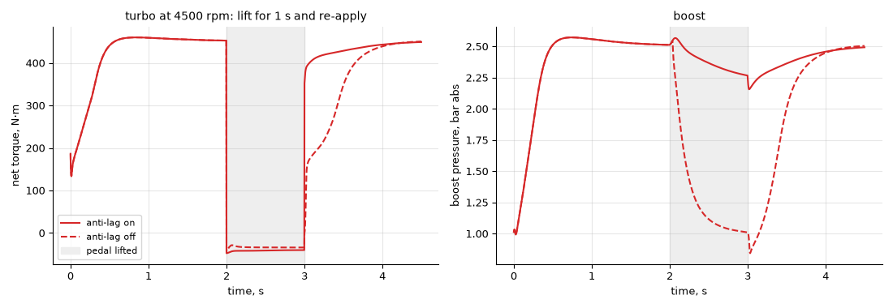

Lift for a second at 4500 rpm and re-apply. Without anti-lag the boost falls to ambient and the torque takes 0.48 s
to come back to 90 %. With it the boost stays above 2.2 bar and the torque is back to 90 % in 0.09 s. Lifted, the
engine brakes a little harder with anti-lag than without (−50 against −44 N·m).

### Idle and the rev limiter

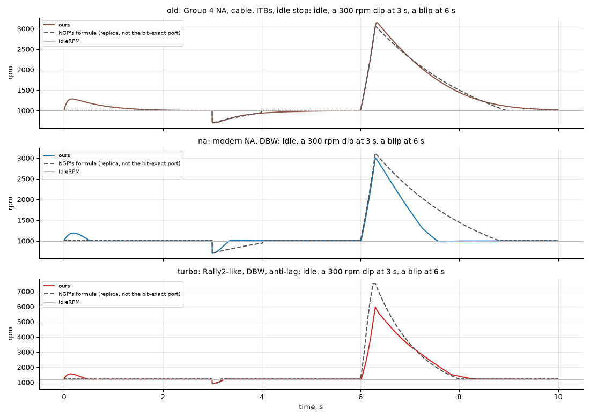

The figure runs each sample in neutral with the car's inertia: idle, a 300 rpm dip at 3 s, then full pedal from 6.0 to
6.3 s. NGP's lines come from a replica of its formula. The ECU cars pull the dip back to within 20 rpm of idle in
about 0.3 s. The old car, with its fixed idle stop, takes 1.1 s to come within 50 rpm, a little longer than NGP. After
the blip the NA car falls faster than NGP, from its stronger braking at low rpm. The turbo car reaches 5800 rpm in the
0.3 s blip where NGP reaches the limiter, because its turbo hasn't spooled.

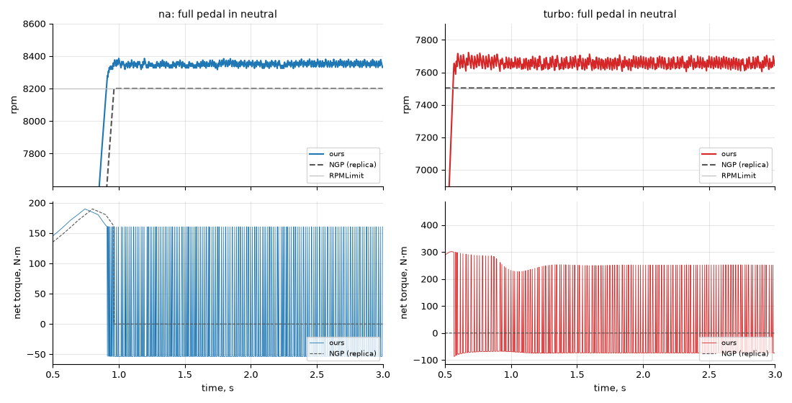

At full pedal in neutral NGP sits on the limit, alternating full torque and braking. Ours cuts firings over the
200 rpm under the limit and bounces 12–80 rpm under it on the NA sample. The turbo sample bounces from 97 rpm under
the limit to 20 over it.

### In game

Every number here was measured at `b97695d86`, the physics that ships: "NGP 7" is NGP 7's physics, "experimental" is
the realistic engine with NGP's tyre (`{ engine: "realistic", tyre: "ngp" }`), so every gap is the engine's.

The autopilot drove each of four RallySimFans cars for 600 s on a gravel stage, track-11_O (Mustaselka), and on a
tarmac one, track-41 (Cote D'Arbroz, its M variant, as the season's weather loads it), once with NGP 7's physics and
once with the experimental physics. Three of them are the cars the samples are modelled on. Only the Fiesta has
drive-by-wire, and its experimental run is with the one to one pedal map. "Over the limit" is the time the engine
spent above `RPMLimit`. "Slip" is the time in gear, above 3 m/s, with the engine more than 3 % above the speed the
gear gives with the clutch engaged, out of about 590 s in gear on gravel and 305–325 s on tarmac (track-41 finishes
in about 5 minutes).

Gravel, track-11_O:

| Car | Physics | Split 2 | Highest rpm over the limit | Over the limit | Slip |
| --- | --- | --- | --- | --- | --- |
| Fiesta Rally2 | NGP 7 | 442.63 s | +34 | 5.0 s | 3.3 s |
| | experimental | 435.66 s | +34 | 0.3 s | 4.3 s |
| Celica ST185 | NGP 7 | 445.47 s | +25 | 5.4 s | 4.6 s |
| | experimental | 437.82 s | −4 | 0 s | 5.5 s |
| Golf II GTI 16V | NGP 7 | 466.95 s | +12 | 5.7 s | 6.0 s |
| | experimental | 447.14 s | −7 | 0 s | 8.6 s |
| Fiat 131 Abarth | NGP 7 | 463.65 s | +13 | 4.5 s | 7.9 s |
| | experimental | 448.53 s | −25 | 0 s | 12.3 s |

Tarmac, track-41:

| Car | Physics | Split 2 | Finish | Highest rpm over the limit | Over the limit | Slip |
| --- | --- | --- | --- | --- | --- | --- |
| Fiesta Rally2 | NGP 7 | 210.71 s | 309.01 s | +25 | 5.0 s | 3.6 s |
| | experimental | 207.41 s | 304.57 s | +44 | 0.2 s | 3.0 s |
| Celica ST185 | NGP 7 | 212.97 s | 310.91 s | +25 | 5.2 s | 3.5 s |
| | experimental | 208.02 s | 305.17 s | −4 | 0 s | 4.0 s |
| Golf II GTI 16V | NGP 7 | 222.28 s | 324.24 s | +21 | 4.7 s | 4.5 s |
| | experimental | 214.14 s | 314.57 s | −7 | 0 s | 5.1 s |
| Fiat 131 Abarth | NGP 7 | 221.31 s | 323.35 s | +13 | 4.2 s | 5.9 s |
| | experimental | 214.91 s | 315.49 s | −15 | 0 s | 6.1 s |

Every run finished or ran its 600 s and was still drivable at the end. One engine stalled, after the finish line: the
experimental Golf, braking at full in fifth on track-41's run-out, locked its wheels at 16 m/s with the clutch still
closed, and the engine fell from 464 rad/s to 0 in 0.8 s; NGP's Golf, in the same stop, kept 89 rad/s ([Known
limits](#known-limits)). The experimental limiter keeps every car under its limit in gear; the Fiesta's time over is
its start burnout in neutral. With the experimental physics the turbo cars reached split 2 1.6–1.7 % sooner on
gravel and 1.6–2.3 % on tarmac, the NA cars 3.3–4.2 % sooner on gravel and 2.9–3.7 % on tarmac. The autopilot's
caution sets most of its pace, and this is one stage and one run per car, so these gaps are not lap times a driver
would see. On gravel the clutch slips 0.9–4.4 s longer per run, on tarmac between 0.6 s shorter and 0.6 s longer,
and the engine's mean distance from the clutch-engaged speed stays at most 2.6 rad/s.

#### 0 to 100 km/h

The autopilot's flat-out standing starts with the Fiesta Rally2 (`--flat-out`), timed from the first move over
0.5 m/s (`harness/car_pace.py`). The start revs to the limiter in neutral on the handbrake and drops into first at
full throttle; NGP's clutch help then closes the clutch. No installed tarmac stage starts flat: the retail French
stages climb 2–15 % over their first 100 m, and the flattest, track-46, bends before 100 km/h; RSF 504 climbs
6.7 %. Retail track-64 (Hualapai Nation, gravel) is flat (0.0 % over its first 100 m) and straight for 100 m.

| Stage | NGP 7 | Experimental |
| --- | --- | --- |
| RSF 504, tarmac, 6.7 % uphill | 4.52 s | 4.46 s |
| track-64, gravel, flat | 4.66 s | 4.63 s |
| RSF 345, gravel, 4 % downhill | 4.50 s | 4.44 s |

Taking the 6.7 % climb's 0.66 m/s² off a constant mean acceleration gives about 4.0 s on flat tarmac for the
experimental run (inferred). The nearest sourced figure is a maker's claim for another Rally2 car: Volkswagen gives
4.1 s for the Polo GTI R5 (1230 kg, 272 PS). No measured figure (GPS onboard, WRC2 telemetry, magazine test) for any Rally2 car was found, and M-Sport
publishes none for the Fiesta.

A launch control (revs held below the limiter, then the throttle holding the wheel slip) was no faster on any of the
three: the tyres pull as hard at about 9 m/s of wheelspin as near their peak at these speeds, and cutting the
throttle loses boost (it bogged the engine to 130 rad/s). The gap to a 3.5 s target is not the start.

## Known limits

- Braking hard enough to lock the driven wheels in a high gear can stall the engine where NGP's would not: the
  experimental Golf II GTI 16V did once, after track-41's finish line ("In game"). The locked wheels pulled the engine
  down with the clutch closed all the way to 0; in the same stop NGP's engine stayed at 89 rad/s with the clutch
  open. Why NGP's clutch help did not open the clutch is not yet traced.
- The turbo sound follows the model: the whine follows its shaft speed and boost, the blow-off its valve, and the
  anti-lag pops play one short burst (0.3-0.7 s) each time its anti-lag starts, and only then. Real rally anti-lag
  bangs about 7 times a second for about 0.5 s per lift, louder still (counted in onboard and roadside videos); ours
  are sparser and quieter, for listening comfort. The whine's pitch is the model's shaft speed times 0.78, to
  stay in the range the 1.02 sim's turbo gave the sound. The blow-off's loudness takes the Fiesta Rally2's valve size
  for every car. A sound bank without backfire sounds, the Fiesta Rally2's among them, plays the pops on the game's
  own pop sounds, which NGP mutes for it, unless its engine recordings already crackle off the throttle. Until the
  model's anti-lag first runs, and on cars without anti-lag, the sound's own crackle still plays on a throttle lift.
- The clutch's capacity is NGP's, sized for its torque. The model's peak torque is the same, so this matters only for
  transient overshoot.
- Damage, overheating and oil starvation reach the model through NGP's damage factor and the 1.02 sim's friction, as
  they reach NGP's formula.
- Modern turbo cars fall short of their table below about 1500 rpm (the held points above). No rally engine's
  low-rpm curve is public. The one measured curve of a base engine we found, PSA's road 1.6 THP (the base of the 208
  and C3 Rally2 engines), makes about 40 % of its peak torque at 1000 rpm and 80 % at 1500 (SAE 2018-01-1423). The
  tables ask for more than that at 1000 rpm, and the model still gives more, so the shortfall is not a reason to add
  low-rpm boost.
- Modern turbo cars idle at 20–22 kPa of manifold pressure against the usual 25–45 kPa of a spark-ignition idle.
- Between idle − 300 rpm and idle a closed pedal still gets the whole idle air ceiling, up to +110 N·m on the turbo
  sample at 1000 rpm. How far below idle a rally ECU's anti-stall reaches is not published; the 300 rpm and the fade to
  half idle are guesses.
- On the limiter the torque swings from step to step with the firing rhythm: the model cuts whole firings, rotating
  the cut as ECUs do. In neutral the HUD's rpm bounces 30–110 rpm from frame to frame under the limit; in gear a few
  rpm. The steering force doesn't show it.

## Tyres

A tyre model is in development and not released: the launcher's Settings page does not offer it, and `--physics
experimental-brush` runs it on top of the engine model (`scripts/launcher.sh --physics experimental-brush`, or `rerbr
--physics experimental-brush`, starts the launcher with it for that session; nothing saves it).
It is a brush model, the textbook physical tyre (Pacejka, *Tire and Vehicle Dynamics*): the tread is a row of bristles that stick to the road at the front of the contact patch and slide at the
rear. It takes the place of NGP's model of the contact patch on hard surfaces at every speed, fitted at load to
give NGP's peak forces and cornering stiffness, with grip that falls as the tyre slides faster and one friction limit
shared by braking and cornering. On gravel and snow the same tyre keeps NGP's peak grip without falling as it
slides, and a locked wheel builds a berm of loose material ahead of it that brakes it harder than rolling, as measured
on gravel.

The model, its evidence, its numbers in game and the open questions are in
[notes/tyre-model.md](../notes/tyre-model.md); the code is in `crates/rbr-tyre`.

### Force curves

Each figure shows the steady force of one tyre, NGP 7's on the left (`ngp`) and the brush on the right
(`experimental-brush`), on the same wheel: a Fiesta Rally2 front wheel with NGP's car data, at 4 kN load and 15 m/s
(54 km/h), dry. A positive slip angle gives a positive side force; a negative slip ratio brakes, -1 is locked. The
peaks come from NGP's grip level by design; the shapes are where the two differ. Every number below is a row of the
tyre scorecard, with its source, in [notes/tyre-model.md](../notes/tyre-model.md#scorecard). In a drive the force
builds over the tyre's relaxation length; these are the values it settles to. `harness/tyre_curves.py` redraws them.

#### Tarmac

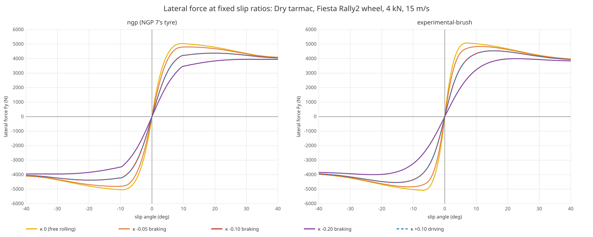

- Side force peaks at a slip angle of 7.0°; measured road and racing tyres peak at 5.6-8.5°, NGP's at 9.5°.
- Fully sideways at 30° the brush keeps 0.89 of its peak and NGP 0.87. Road tyres keep 0.73-0.83 and racing tyres
  0.80-0.90, so both sit at the forgiving end.
- Braking at a slip ratio of 0.25 while cornering at 4°, the brush keeps 0.29 of its side force, inside the measured
  0.29-0.34; NGP keeps 0.46.

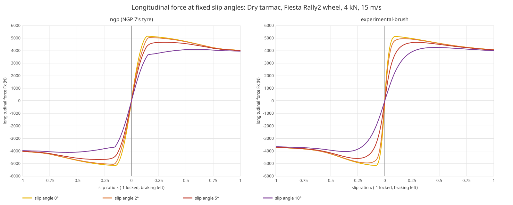

- Braking and driving force peak at a slip ratio of 0.09 (NGP 0.15); measured 0.08-0.18.
- Locked, the brush keeps 0.72 of its peak braking force and NGP 0.78; measured car tyres 0.58-0.885.

#### Gravel

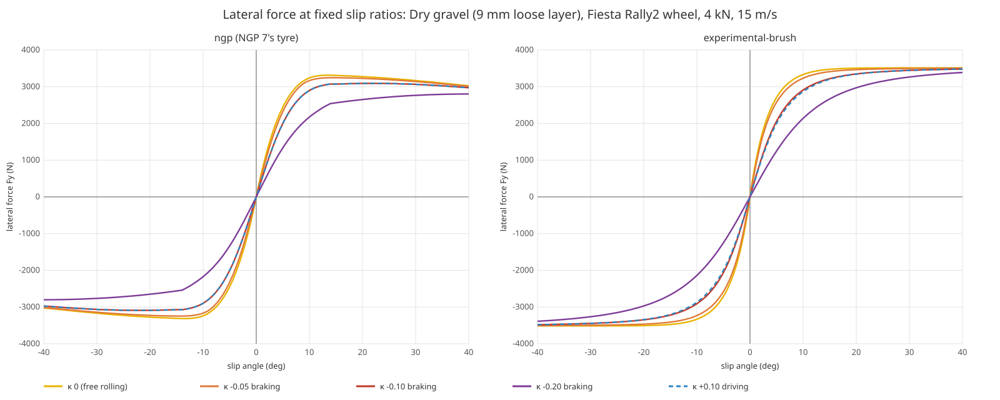

- The brush builds side force more slowly the deeper the loose layer under it, and keeps it: 90 % of its maximum at
  8° on NGP's shallow gravel (9 mm, the figure), 11° on its deep gravel (17.5 mm) and 14° from 25 mm, with no fall
  to 40°. Measured: a WRC car on a stage road about 12°, a tyre on deep loose pea stone 14.5° (at walking pace, level
  to 38°), a car on a firm gravel lot 3°. NGP's reaches 90 % at 7.5° on every depth and falls to 0.91 of its peak by
  40°.
- At 10° the brush has 0.95 of its maximum on 9 mm, 0.88 on 17.5 mm and 0.80 from 25 mm (the pea stone tyre 0.80),
  NGP's 0.98.

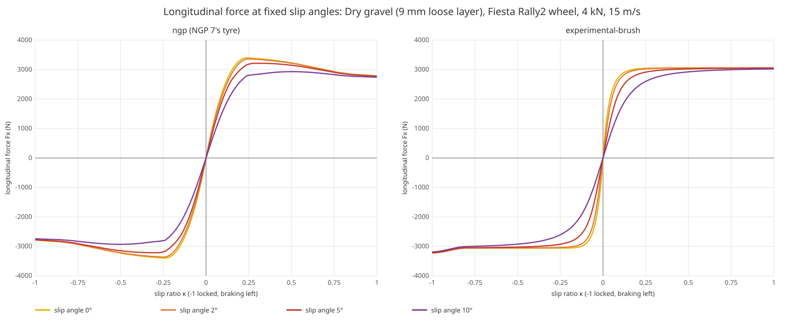

- Braking force levels off from a slip ratio of about 0.15 (0.25 on deep layers) and holds to 0.8. Past that the wheel pushes a berm of
  gravel ahead of it, and locked it brakes 1.3 times its rolling peak. Measured cars on gravel stop 1.12-1.59 times
  harder locked than with ABS; the Fiesta Rally2 under the brush 1.29-1.44, under NGP 1.08-1.10.
- Driving force levels off and does not fall at full spin, where NGP's falls to 0.82 of its peak. No measured curve on
  gravel reaches full spin, so this part is open.

#### Snow

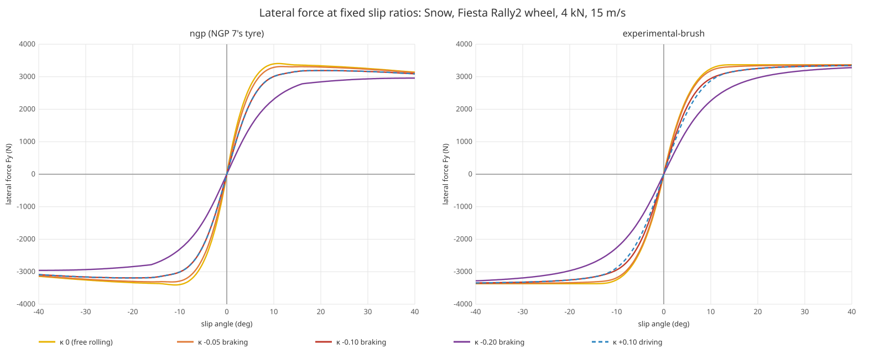

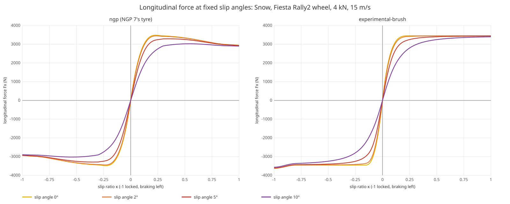

- Side force levels off from about 12° and does not fall; its maximum is at 14.75° (NGP 11°), measured on packed snow
  9-18°.
- The berm on snow is small: locked, the wheel brakes 1.05 times its rolling peak. Studded tyres on compacted snow
  lock at 1.02-1.08 times their braking at 15-20 % slip; the Fiesta Rally2 under the brush 1.05-1.09.

## Sources

The full list, with the line each one supports, is in [notes/engine-model.md](../notes/engine-model.md#sources).

- SAE 2018-01-1423, full load of PSA's 1.6 THP: https://www.epa.gov/sites/default/files/2018-10/documents/sae-paper-2018-01-1423.pdf

- Andersson, mean-value engine and turbo model, Linköping MSc 2017: https://www.diva-portal.org/smash/get/diva2:1138994/FULLTEXT01.pdf
- Hendricks and Sorenson, mean-value SI engine model: https://orbit.dtu.dk/en/publications/mean-value-si-engine-model-for-control-studies
- Moraal & Kolmanovsky, turbocharger modelling (SAE 1999-01-0908): https://www.researchgate.net/publication/244520704_Turbocharger_Modeling_for_Automotive_Control_Applications
- Boost spikes on spring wastegates, enginebasics: https://enginebasics.com/Advanced%20Engine%20Tuning/Boost%20Spiking.html
- Pressure delay in hoses, Thomasson 2014 (Linköping dissertation 1590): https://www.diva-portal.org/smash/get/diva2:709572/FULLTEXT01.pdf
- NASA, choked mass flow: https://www.grc.nasa.gov/www/k-12/airplane/mflchk.html
- Throttle plate area, US 6591667: https://patents.google.com/patent/US6591667
- Sandoval–Heywood friction model, as transcribed in ESA.NET: https://github.com/pangtuwi/ESA.NET/pull/223
- Engine oil viscosity, Anton Paar: https://wiki.anton-paar.com/us-en/engine-oil/
- Pumping losses, TAMU: https://oaktrust.library.tamu.edu/server/api/core/bitstreams/161c947f-2eff-48dd-8bf4-80912a8bec75/content
- Willans line, Moretto 2024: https://www.dora.lib4ri.ch/empa/dload/empa:36100/PDF/Moretto-2024-A_method_to_quantify_the-(published_version).pdf
- Spark retard and torque, MIT 2.61: https://web.mit.edu/2.61/www/Lecture%20notes/Lec.%2009%20SI%20engine%20combustion%20I.pdf
- Spark efficiency curve, US 6363317: https://image-ppubs.uspto.gov/dirsearch-public/print/downloadPdf/6363317
- Idle spark reserve, arXiv 2012.02859: https://arxiv.org/abs/2012.02859
- Idle reserve use, US 7418943: https://image-ppubs.uspto.gov/dirsearch-public/print/downloadPdf/7418943
- MoTeC M1 idle: https://motec.zendesk.com/hc/en-gb/articles/14575739507727-Checklist-Idle-Setup
- Link G4+ idle, anti-stall gain: https://www.hpacademy.com/courses/link-g4-plus-software-tutorial/advanced-fuctions-idle-speed-control/
- Overrun fuel cut, MSExtra: https://www.msextra.com/forums/viewtopic.php?t=33238
- Decel manifold pressure: https://forums.autosport.com/topic/89377-f1-engines-and-engine-braking/
- rFactor 2 engine file, coast torque: http://tirewall.net/mh-rf2/vehicle/physics/engine_ini.html
- Link G4+ limiter, HP Academy webinar 084: https://www.hpacademy.com/previous-webinars/084-link-g4-rev-limit-configuration/
- Limiters, HP Academy webinar 171: https://www.hpacademy.com/previous-webinars/171-configuring-the-ultimate-rpm-limiter/
- Drive-by-wire tuning, HP Academy webinar 138: https://www.hpacademy.com/previous-webinars/138-tuning-drive-by-wire-throttle-control/
- MoTeC Hundred series drive-by-wire: https://motec.zendesk.com/hc/en-gb/articles/15859133831823-Hundred-series-ECU-DBW-setup-information
- Life Racing on M-Sport's R5: https://autosporttech.co.nz/life-racing/
- Bosch ME7 torque structure: https://www.rbracing-rsr.com/turbo/indian_chief/Bosch_ME7_Torque.pdf
- MoTeC M1 boost aim: https://www.hpacademy.com/courses/boost-control/motec-m1-closed-loop-boost-control-tuning/
- Link G4+ boost target: https://www.hpacademy.com/courses/link-g4-plus-software-tutorial/advanced-fuctions-closed-loop-boost-control/
- Turbo tip-in times and inertia, Chalmers: https://publications.lib.chalmers.se/records/fulltext/255844/255844.pdf
- MoTeC anti-lag: https://motec.zendesk.com/hc/en-gb/articles/14565159804687-Checklist-Anti-Lag-Setup
- Link e-throttle anti-lag: https://forums.linkecu.com/topic/14055-e-throttle-antilag-setup/
- Ignition cuts and exhaust flow, CSP's powertrain notes: https://github.com/AssettoCN/ac-docs/blob/main/docs/en/car/physics/powertrain.md
- FIA turbo restrictors, rallycars.com: https://rallycars.com/technical-stuff/fia-turbo-restrictors/
- FIA Article 254A (2013), Super 2000: https://www.fia.com/sites/default/files/regulation/file/254A%20(2013).pdf
- FIA Article 255 (2019), Group A and Super 1600: https://www.fia.com/sites/default/files/255_2019_wmsc_2018_12.05.pdf
- FIA Article 255A (2016), WRC: https://www.fia.com/sites/default/files/255a_2016-corrected_16.12.2015.pdf
- FIA Article 260 (2021), R1–R3, Rally3–5: https://www.fia.com/sites/default/files/260_2021_wmsc_2020.12.16.pdf
- FIA Article 261 (2023), Rally2: https://www.fia.com/sites/default/files/261_2023.pdf
- MoTeC M1 drive-by-wire, throttle aim as airflow (HP Academy): https://www.hpacademy.com/courses/motec-m1-software-tutorial/additional-functions-dbw-throttle/
- EPA engine benchmarking, 2013 Ford 1.6 L EcoBoost steady map: https://www.epa.gov/vehicle-and-fuel-emissions-testing/benchmarking-advanced-low-emission-light-duty-vehicle-technology
- BeamNG.drive, modelling part-throttle torque curves: https://beamng.com/game/news/blog/throttle-torque-curves/
- Niels Heusinkveld, throttle models in sims: https://www.youtube.com/watch?v=0gW-cbSX3Uc
- BeamNG engine braking and friction, a forum reading of its engine code: https://www.beamng.com/threads/engine-braking-calculations-wrong.94673/
- Volkswagen, Polo GTI R5 0-100 km/h 4.1 s (maker's claim): https://www.volkswagen-newsroom.com/en/the-new-polo-gti-driving-presentation-2512/the-new-polo-gti-r5-gti-goes-rallying-2567
