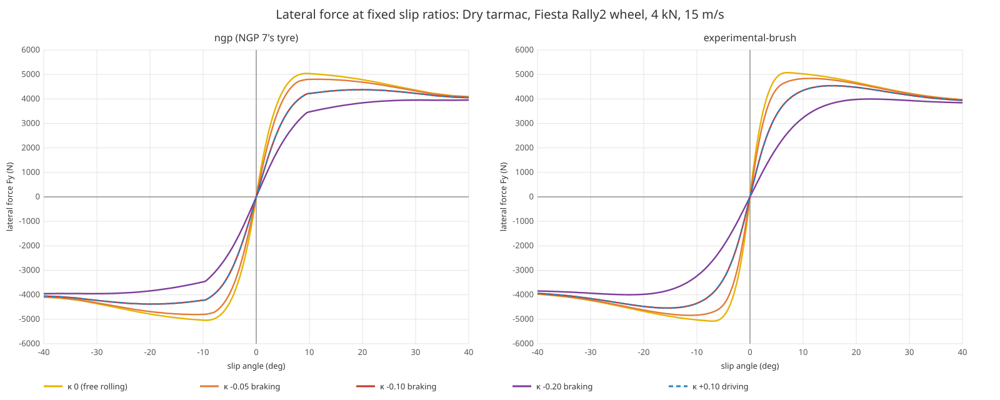
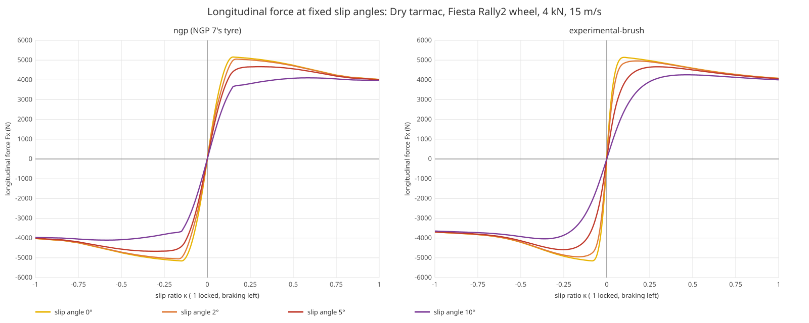
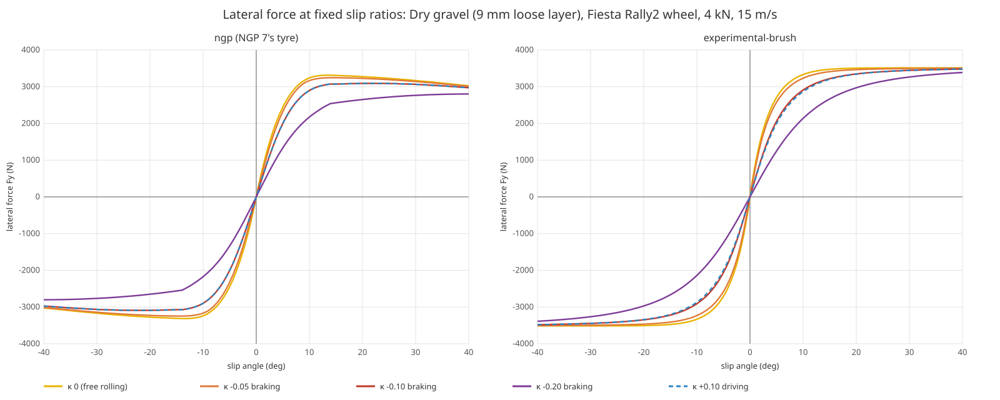
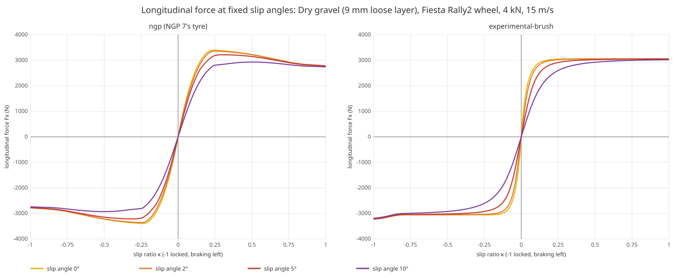
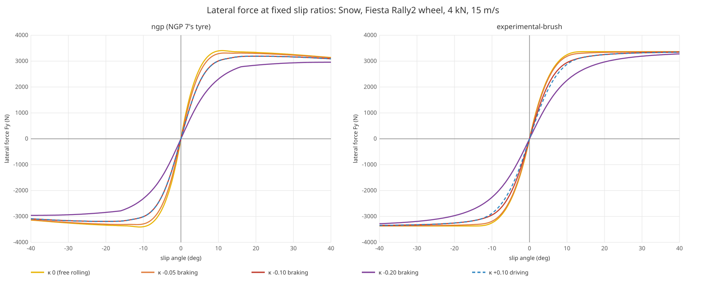
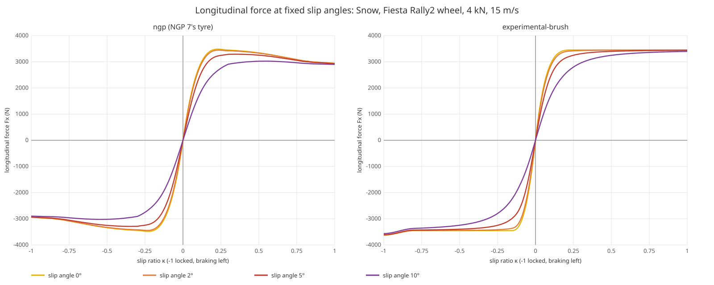

# ReRBR experimental tyre model

A tyre model is in development and not released: the launcher's Settings page does not offer it, and `--physics
experimental-brush` runs it on top of the engine model of [ReRBR experimental physics](experimental-physics.md)
(`scripts/launcher.sh --physics experimental-brush`, or `rerbr --physics experimental-brush`, starts the launcher with
it for that session; nothing saves it).

It is a brush model, the textbook physical tyre (Pacejka, *Tyre and Vehicle Dynamics*): the tread is a row of bristles
that stick to the road at the front of the contact patch and slide at the rear. It takes the place of NGP's model of
the contact patch on hard surfaces at every speed, fitted at load to give NGP's peak forces and cornering stiffness,
with grip that falls as the tyre slides faster and one friction limit shared by braking and cornering. On gravel and
snow the same tyre keeps NGP's peak grip without falling as it slides, and a locked wheel builds a berm of loose
material ahead of it that brakes it harder than rolling, as measured on gravel.

The model, its evidence, its numbers in game and the open questions are in
[notes/tyre-model.md](../notes/tyre-model.md); the code is in `crates/rbr-tyre`.

## Force curves

Each figure shows the steady force of one tyre, NGP 7's on the left (`ngp`) and the brush on the right
(`experimental-brush`), on the same wheel: a Fiesta Rally2 front wheel with NGP's car data, at 4 kN load and 15 m/s
(54 km/h), dry. A positive slip angle gives a positive side force; a negative slip ratio brakes, -1 is locked. The
peaks come from NGP's grip level by design; the shapes are where the two differ. Every number below is a row of the
tyre scorecard, with its source, in [notes/tyre-model.md](../notes/tyre-model.md#scorecard). In a drive the force
builds over the tyre's relaxation length; these are the values it settles to. `harness/tyre_curves.py` redraws them.

### Tarmac

- Side force peaks at a slip angle of 6.5°; measured road and racing tyres peak at 4.5-8.5°, NGP's at 9.5°.
- Past the peak the brush has lost 3 % by 10.5°, the gentlest of a measured racing tyre's 3-12 % there; NGP has lost
  0.3 %. No rally tyre has been measured: it is taken as no sharper than the slick.
- Fully sideways at 30° the brush keeps 0.84 of its peak, the level chosen by driving, and NGP 0.87. Road tyres keep
  0.73-0.83 and racing tyres 0.80-0.90: the brush sits where the two meet, NGP at the forgiving end.
- Braking at a slip ratio of 0.25 while cornering at 4°, the brush keeps 0.29 of its side force, above the measured
  0.23-0.27; NGP keeps 0.46.

- Braking and driving force peak at a slip ratio of 0.09 (NGP 0.15); measured 0.08-0.18.
- Locked, the brush keeps 0.72 of its peak braking force and NGP 0.78; measured car tyres 0.58-0.885.
- The damp tarmac tyre is the best choice on a damp road, where NGP's only ties the dry tyre: it gains 8 % over the dry
  tyre there, what NGP's wet tyre gains over the dry one on a wet road, and loses 2 % to it on a dry road. Tread
  compounds alone rate 95-120 % of a control on wet roads. From 50 km/h on damp tarmac the Fiesta Rally2 brakes
  locked at 1.07 of the dry tyre (NGP 1.00).

### Gravel

- The brush builds side force more slowly the deeper the loose layer under it, and keeps it: 90 % of its maximum at
  8° on NGP's shallow gravel (9 mm, the figure), 11° on its deep gravel (17.5 mm) and 14° from 25 mm, with no fall
  to 40°. Measured: a WRC car on a stage road about 12°, a tyre on loose pea stone over asphalt 14.5° (at walking pace,
  level to 38°), a car on a firm gravel lot 3°. NGP's reaches 90 % at 7.5° on every depth and falls to 0.91 of its peak
  by 40°.
- At 10° the brush has 0.95 of its maximum on 9 mm, 0.88 on 17.5 mm and 0.80 from 25 mm (the pea stone tyre 0.80),
  NGP's 0.98.

- Braking force levels off from a slip ratio of about 0.15 (0.25 on deep layers) and holds to 0.8. Past that the wheel
  pushes a berm of gravel ahead of it, and locked it brakes 1.3 times its rolling peak. Measured cars on gravel stop
  1.12-1.59 times harder locked than with ABS; the Fiesta Rally2 under the brush 1.29-1.44, under NGP 1.08-1.10.
- Driving force levels off and does not fall at full spin, where NGP's falls to 0.82 of its peak. No measured curve on
  gravel reaches full spin, so this part is open.
- Damp gravel grips as dry gravel, where NGP's loses 7.5 %: the one gravel road measured dry and sprinkled skidded as
  hard or harder wetted, and no measurement shows a damp loss. Wet gravel keeps NGP's 0.85 of dry, inside the 0.76-0.90
  measured on gravel roads. From 50 km/h the Fiesta Rally2 brakes locked on damp gravel at 1.01 of dry (NGP 0.93).

### Snow

- Side force levels off from about 12° and does not fall; its maximum is at 14.75° (NGP 11°), measured on packed and
  loose snow 9-18°.
- The berm on snow is small: locked, the wheel brakes 1.05 times its rolling peak. Studded tyres on compacted snow
  lock at 1.02-1.10 times their braking at 15-20 % slip; the Fiesta Rally2 under the brush 1.05-1.09.
