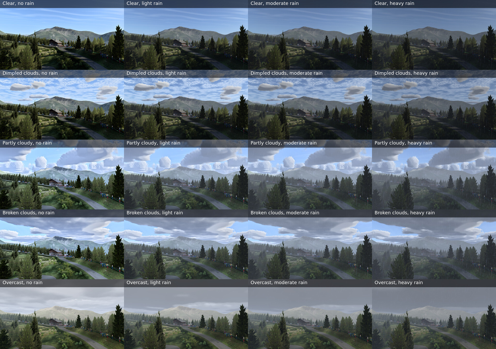
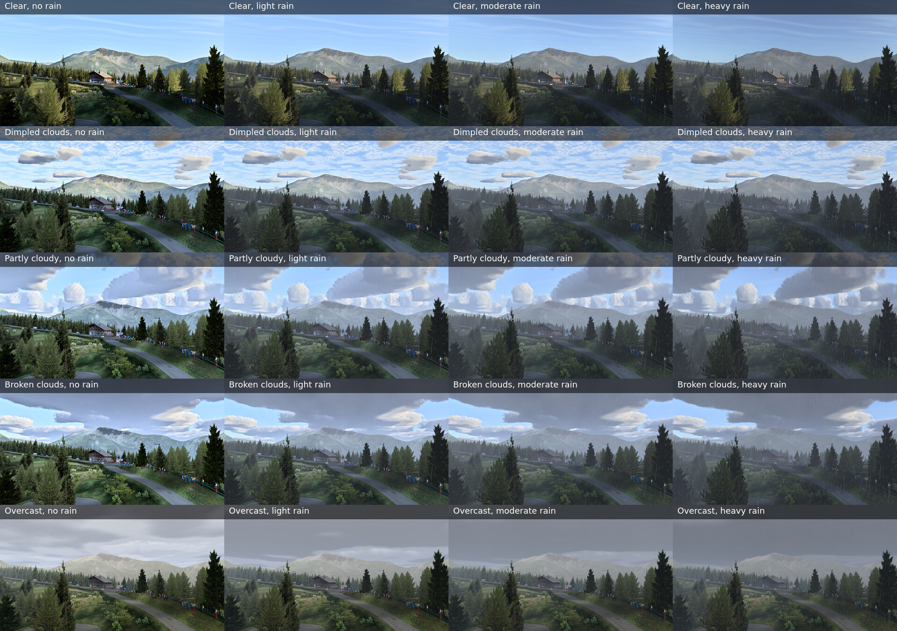
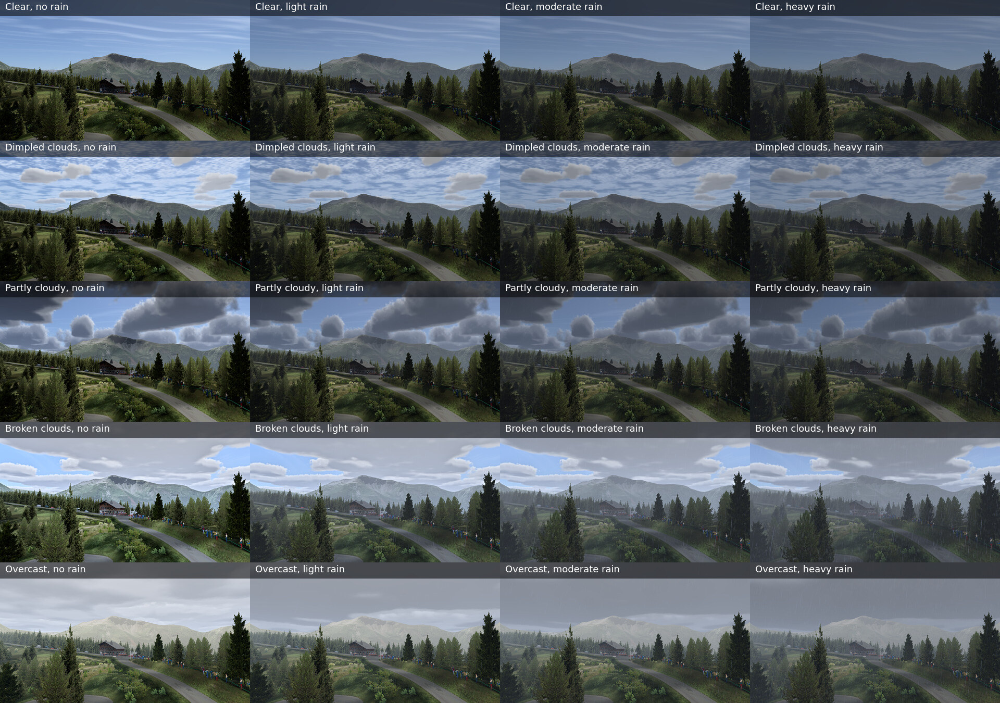
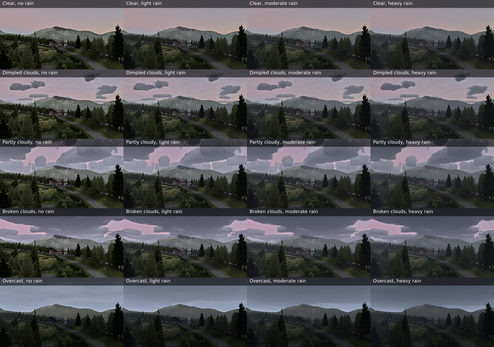
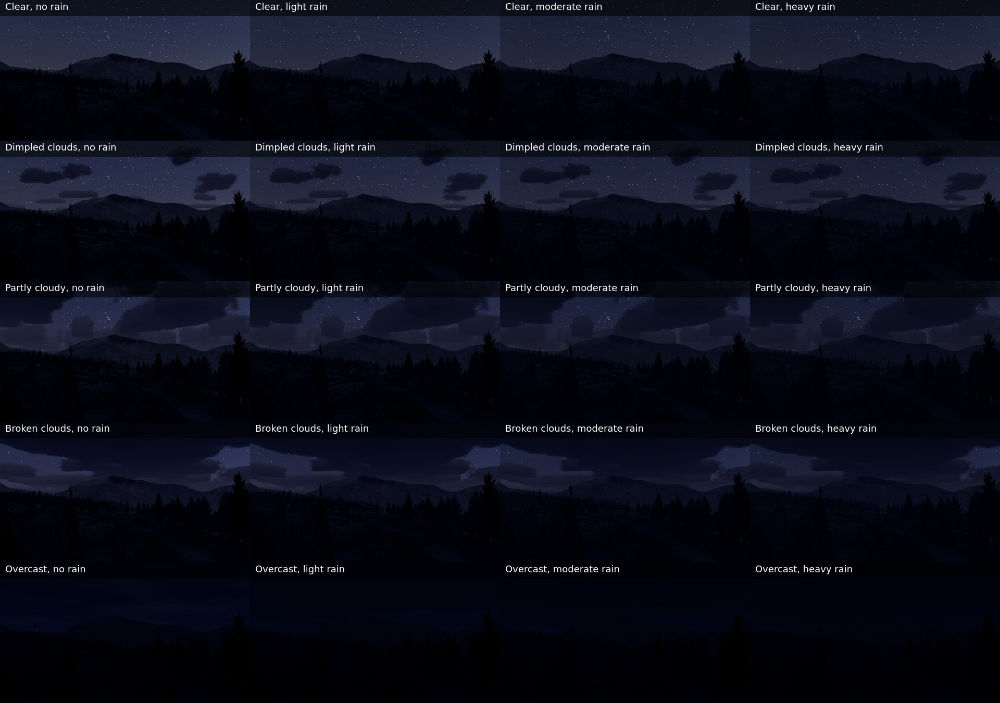

# Weather reference

One view with the sky well in frame (the Joux Verte reference shot's stage, from 6 m higher and pitched
6 degrees up, 70 degrees of field of view) under every cloud cover, moment of the day and rain the launcher
offers: per moment, rows are the clouds and columns the rain, the road dry, every enhancement on. Made by
`scripts/weather-sheet.py`; regenerate with `scripts/weather-sheet.py --doc docs/weather` and compare before
and after a change to the sky, clouds, haze, rain or the exposure.

## Best light

## Golden hour

## Midday

## Dusk

## Night

